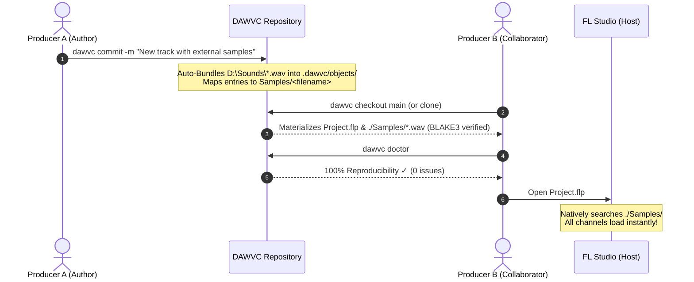

# Zero-Config Collaborator Workflow & Sample Management

## 1. Overview & Core Philosophy

In traditional music production collaboration, sharing projects between different producers often results in the infamous **"Missing Files"** dialog because:
- Producer A keeps sample-packs on `D:\Sounds\Cymatics\...`.
- Producer B keeps sample-packs on `E:\AudioLibraries\...` or `C:\Users\ProducerB\Downloads`.
- Absolute file paths stored inside native project files (`.flp`, `.als`, etc.) fail on any workstation except the author's.

DAWVC resolves this with **Zero-Config Audio Versioning**:
1. **Authoring (Producer A):** Producer A works naturally without manually organizing or copying samples into the project folder. External samples from DAW search paths or central drives are auto-discovered during `dawvc doctor` and `dawvc commit`.
2. **Bundling (Repository Storage):** Referenced audio files are hashed with BLAKE3 and bundled as immutable content-addressed blobs in `.dawvc/objects/`, mapped to snapshot paths under `Samples/<filename>`.
3. **Collaboration (Producer B):** When Producer B clones or checks out the repository, DAWVC automatically restores the primary project file and materializes all bundled audio samples directly into `./Samples/`.
4. **Zero Missing Files in DAW:** Modern DAWs (including FL Studio) inherently search the folder containing the project file and its immediate subdirectories (`./Samples/`). When Producer B opens `Project.flp`, all samples load immediately without any manual configuration or missing-file prompts.



---

## 2. Producer A (Author) Workflow

### 2.1 Working with External Samples
You can load samples from anywhere on your PC:
- FL Studio Browser Extra Search Folders (e.g. `D:\Sounds`, `C:\Packs`)
- Splice Sounds folder
- Shared Image-Line sample packs

### 2.2 Diagnosing with `dawvc doctor`
Run:
```powershell
dawvc doctor
```
DAWVC inspects your FL Studio registry and search paths, finds all referenced samples, verifies their hashes, and confirms 100% dependency health.

### 2.3 Committing Changes
Run:
```powershell
dawvc commit -m "Added drum pattern and vocal chops"
```
DAWVC automatically reads external samples from your central drives, writes them as content-addressed blobs into `.dawvc/objects/`, and tracks them in the project snapshot under `Samples/`.

> **Note on `--consolidate`:**  
> By default, DAWVC leaves your local files on `D:\Sounds\...` untouched so your existing project references remain valid.  
> If you *also* want external samples copied into your local workspace `./Samples/`, pass the `--consolidate` flag:
> ```powershell
> dawvc commit -m "Consolidated commit" --consolidate
> ```

---

## 3. Producer B (Collaborator) Workflow

### 3.1 Initial Checkout / Clone
When receiving the repository, check out the project:
```powershell
dawvc checkout main --force
```
*(Or use `dawvc checkout <commit-hash> --restore-to <target-directory>` to export cleanly).*

DAWVC will output:
```text
✓ Successfully checked out snapshot abc12345 to C:\Projects\MyTrack
  + Primary project: Track.flp
  + 65 bundled audio sample(s) materialized in './Samples/'
Instructions & Next Steps:
  • FL Studio project assets materialized in './Samples/'. FL Studio discovers project folder assets automatically on project load.
```

### 3.2 Verification with `dawvc doctor`
Before launching the DAW, run:
```powershell
dawvc doctor
```
Expected output:
- **Reproducibility Score:** `100.0%`
- **Artifact Integrity:** `✓ Project.flp Healthy`
- **Dependency Health:** All samples marked as `✓ Verified (RepositoryAsset)` in `./Samples/`.

### 3.3 Opening the Project
Open `Track.flp` in FL Studio. FL Studio automatically discovers all samples located in the `./Samples/` subfolder. No relinking or search-folder configuration is needed.

### 3.4 Working on Branches & Switching
Collaborators can create branches, add new samples, and switch branches seamlessly:
```powershell
# Create a new feature branch
dawvc switch feature-synth -c

# Add and stage new samples
dawvc add Samples/LeadTake.wav
dawvc commit -m "Added lead synth take"

# Switch back to main
dawvc switch main
```
When switching between branches, DAWVC automatically adds or removes the corresponding files in `./Samples/` to match the target commit snapshot.

---

## 4. Protected Proprietary Libraries (Kontakt, Omnisphere, etc.)

To prevent repository bloat and respect software licenses:
- Large multi-gigabyte instrument libraries (e.g. Native Instruments Kontakt, Spectrasonics Omnisphere, reFX Nexus) are **not** bundled by default.
- They are classified as `UserChoice` or `ReferenceOnly`.
- If Collaborator B does not have a required commercial library installed, `dawvc doctor` will clearly flag it as a missing plugin or content dependency without corrupting or breaking the project file.

---

## 5. Transfer Preview and Interruption Limits (24 October 2026)

Filesystem, external-drive and UNC collaboration is supported; HTTPS and push are not supplied by these workflows. The desktop client is still planned.

A fetch/pull dry-run is **not a write-free preview**: it creates local quarantine directories, downloads/verifies commit and snapshot metadata, and prunes stale incoming sessions. It skips blob download, object promotion and tracking-ref updates. A failed/interrupted preview may leave quarantine files. Pull dry-run can classify against existing local tracking refs rather than the prospective remote tip; do not treat it as an authoritative preflight for a later integration.

Normal fetch promotes verified objects incrementally and updates tracking refs separately. A failed transfer can therefore leave useful objects and partially updated refs. Clone has no whole-target rollback, and a post-checkout diagnostic/dependency failure can happen after workspace publication. Preserve the target/recovery data and inspect the actual state before retrying destructive actions; see [Recovery Guide](Recovery_Guide.md) and the [operation inventory](GUI_Operation_Inventory.md).

These are source-audit findings recorded for WP2/WP7, not newly implemented transfer or recovery behavior.
