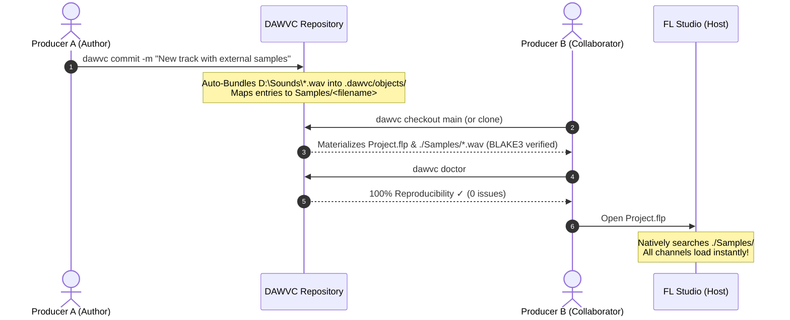

# Zero-Config Collaborator Workflow & Sample Management

## 1. Overview & Core Philosophy

In traditional music production collaboration, sharing projects between different producers often results in the infamous **"Missing Files"** dialog because:
- Producer A keeps sample-packs on `D:\Sounds\Cymatics\...`.
- Producer B keeps sample-packs on `E:\AudioLibraries\...` or `C:\Users\ProducerB\Downloads`.
- Absolute file paths stored inside native project files (`.flp`, `.als`, etc.) fail on any workstation except the author's.

DAWVC resolves this with **Zero-Config Audio Versioning**:
1. **Authoring (Producer A):** Producer A works naturally without manually organizing or copying samples into the project folder. External samples from DAW search paths or central drives are auto-discovered during `dawvc doctor` and `dawvc commit`.
2. **Bundling (Repository Storage):** Referenced audio files are hashed with BLAKE3 and bundled as immutable content-addressed blobs in `.dawvc/objects/`, mapped to snapshot paths under `Samples/<filename>`.
3. **Collaboration (Producer B):** When Producer B clones or checks out the repository, DAWVC automatically restores the primary project file and materializes all bundled audio samples directly into `./Samples/`.
4. **Zero Missing Files in DAW:** Modern DAWs (including FL Studio) inherently search the folder containing the project file and its immediate subdirectories (`./Samples/`). When Producer B opens `Project.flp`, all samples load immediately without any manual configuration or missing-file prompts.



---

## 2. Producer A (Author) Workflow

### 2.1 Working with External Samples
You can load samples from anywhere on your PC:
- FL Studio Browser Extra Search Folders (e.g. `D:\Sounds`, `C:\Packs`)
- Splice Sounds folder
- Shared Image-Line sample packs

### 2.2 Diagnosing with `dawvc doctor`
Run:
```powershell
dawvc doctor
```
DAWVC inspects your FL Studio registry and search paths, finds all referenced samples, verifies their hashes, and confirms 100% dependency health.

### 2.3 Committing Changes
Run:
```powershell
dawvc commit -m "Added drum pattern and vocal chops"
```
DAWVC automatically reads external samples from your central drives, writes them as content-addressed blobs into `.dawvc/objects/`, and tracks them in the project snapshot under `Samples/`.

> **Note on `--consolidate`:**  
> By default, DAWVC leaves your local files on `D:\Sounds\...` untouched so your existing project references remain valid.  
> If you *also* want external samples copied into your local workspace `./Samples/`, pass the `--consolidate` flag:
> ```powershell
> dawvc commit -m "Consolidated commit" --consolidate
> ```

---

## 3. Producer B (Collaborator) Workflow

### 3.1 Initial Checkout / Clone
When receiving the repository, check out the project:
```powershell
dawvc checkout main --force
```
*(Or use `dawvc checkout <commit-hash> --restore-to <target-directory>` to export cleanly).*

DAWVC will output:
```text
✓ Successfully checked out snapshot abc12345 to C:\Projects\MyTrack
  + Primary project: Track.flp
  + 65 bundled audio sample(s) materialized in './Samples/'
Instructions & Next Steps:
  • FL Studio project assets materialized in './Samples/'. FL Studio discovers project folder assets automatically on project load.
```

### 3.2 Verification with `dawvc doctor`
Before launching the DAW, run:
```powershell
dawvc doctor
```
Expected output:
- **Reproducibility Score:** `100.0%`
- **Artifact Integrity:** `✓ Project.flp Healthy`
- **Dependency Health:** All samples marked as `✓ Verified (RepositoryAsset)` in `./Samples/`.

### 3.3 Opening the Project
Open `Track.flp` in FL Studio. FL Studio automatically discovers all samples located in the `./Samples/` subfolder. No relinking or search-folder configuration is needed.

### 3.4 Working on Branches & Switching
Collaborators can create branches, add new samples, and switch branches seamlessly:
```powershell
# Create a new feature branch
dawvc switch feature-synth -c

# Add and stage new samples
dawvc add Samples/LeadTake.wav
dawvc commit -m "Added lead synth take"

# Switch back to main
dawvc switch main
```
When switching between branches, DAWVC automatically adds or removes the corresponding files in `./Samples/` to match the target commit snapshot.

---

## 4. Protected Proprietary Libraries (Kontakt, Omnisphere, etc.)

To prevent repository bloat and respect software licenses:
- Large multi-gigabyte instrument libraries (e.g. Native Instruments Kontakt, Spectrasonics Omnisphere, reFX Nexus) are **not** bundled by default.
- They are classified as `UserChoice` or `ReferenceOnly`.
- If Collaborator B does not have a required commercial library installed, `dawvc doctor` will clearly flag it as a missing plugin or content dependency without corrupting or breaking the project file.

## Hosting-independent collaboration over SSH

A host operator configures an alias and per-key/account read/write permissions
([setup](Self_Hosting_SSH.md)). Contributors can then use:

```powershell
dawvc clone dawvc://alice@studio-host/projects/song Song
cd Song
# Edit, stage and commit as usual
dawvc push
dawvc pull
```

Use independently verified SSH host keys and public-key authentication. PC, NAS
and server hosts use the same protocol; standard Git hosting is a different
protocol. A non-bare host's active branch cannot receive Push. Push publishes
committed history without changing the host workspace; divergence requires
explicit integration, not force-push.


## First publication to your own hosting storage

On the host or a machine with the storage mounted, provision a receiver from the
existing project rather than independently generating a different project ID:

```powershell
dawvc init --bare --from D:\Music\Song --dir D:\Hosting\Song
# Or copy all existing history immediately (choose one provisioning command):
# dawvc clone D:\Music\Song D:\Hosting\Song --bare
```

For a share, configure the resulting filesystem path as origin on the producer.
For SSH, configure its host-owned alias and explicitly permit Push first, then:

```powershell
dawvc remote add origin dawvc://producer@host/projects/song
dawvc push origin main
```

Collaborators use normal `dawvc clone`, not `clone --bare`, to obtain working
files. Neither provisioning command copies source bindings/index or installs
plugins. Targets must be absent/empty. Fast-forward-only collaboration and FL
Studio search-folder/relinking requirements remain unchanged.


## Resolving two independently committed project versions

First commit/save your own work, then fetch the other producer's history. If Pull
rejects divergence, inspect both versions separately before choosing:

```powershell
dawvc fetch origin
# Optional: inspect the fetched version outside your workspace:
dawvc checkout origin/main --restore-to D:\Review\IncomingSong
# Choose one entire snapshot, retaining both histories:
dawvc merge origin/main --take incoming -m "Use incoming arrangement and samples"
# Alternatively --take local retains your committed project and recorded assets.
dawvc push origin main
```

This choice applies to the whole project, including bundled samples/dependencies;
it is not a per-track/per-file merge. Both parent IDs appear in `dawvc log` and
can be restored with `checkout <full-id> --restore-to <empty-directory>`. To combine
musical ideas manually, restore the other version separately, edit in FL Studio,
explicitly add any newly imported assets, and commit the result normally.

Merge refuses staged or modified/missing tracked work and untracked collisions.
It does not fetch automatically, install plugins or configure FL Studio search
paths. Do not run simultaneous local mutating commands. If the remote advances
before Push, fetch and reassess; no force-push or history rewriting is needed.


## Preview acceptance and deployment qualification

See [Preview acceptance](Preview_Acceptance.md) for automated packaged-CLI evidence
and the separate real Windows/FL Studio/two-PC/OpenSSH/NAS checklist. Synthetic
single-host success does not certify native playback or deployment-specific
locking/rename behavior. Those release gates remain pending until measured on
actual supported setups; no GUI or additional DAW support is implied.


## Choose a persistent sync target (WP-SYNC-09)

After adding a remote, configure the active local branch once:

```powershell
dawvc remote track backup published
dawvc fetch backup published --dry-run
dawvc pull --dry-run
dawvc push
dawvc pull
```

The configured upstream is backup/published even when the active local branch has
another name. `push backup`/`pull backup` keep that mapping. An explicit Pull branch
is a remote source into the active branch, not a local branch switch. Track works
offline and allows a future remote branch; `--local-branch mix` configures another
existing local branch without switching it.

Fresh previews do not modify repository files/layout or prune incoming sessions.
They estimate transfers from bounded metadata and do not plan unsaved work or
verify remote blob availability. Actual execution fetches again and may see a new
tip. Keep previews advisory during other writers. Track/real operations respect
operation ownership and pending recovery; await Busy owners and inspect recovery.
Ctrl+C is forwarded for all sync commands; durable effects can remain after exit 130.
### Tracking a shared branch

Use `dawvc remote track origin shared-mix` to map the active local branch to a
differently named remote branch before publishing. Plain Push/Pull then use that
mapping. `pull origin shared-mix` integrates into the current local branch; use
`switch` separately when you intend to change local branches. Cancellation is
available on clone/fetch/pull/push, but does not undo every durable effect.

### Preview before integrating

`dawvc pull --dry-run` now reads current remote metadata without updating tracking
refs or downloading blob bodies. It works with stale/missing tracking caches and
reports divergence before workspace changes. `fetch origin --dry-run` also lists
planned ref updates. Neither operation forecasts dirty-workspace conflicts or
reserves remote refs; verify unsaved work separately and run actual Pull to fetch
and apply the latest validated state.
