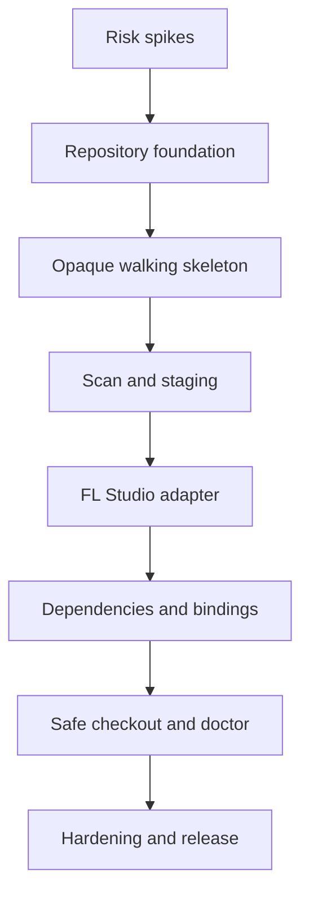

# DAWVC — MVP Implementation Plan

> **Document Version:** 1.0  
> **Status:** Approved implementation baseline  
> **Target Release:** MVP v0.1 public technical preview  
> **Normative Requirements:** `DAWVC_MVP_Requirements.md` v1.0  
> **Normative Architecture:** `DAWVC_Technical_Design.md` v1.1  
> **Team Model:** Single developer  
> **Estimation Unit:** Ideal engineering days, without calendar deadlines

---

# 1. Objective

This plan translates the MVP requirements into an executable development progression. The plan focuses on delivering early working vertical slices, demonstrable integrity, and controlled risk mitigation.

The first tangible result is not the complete dependency adapter, but a walking skeleton capable of committing a `.flp` project opaquely, visualizing it in commit history, and restoring it byte-identically. Inspection, dependencies, bindings, and diagnostics are integrated incrementally thereafter.

---

# 2. Foundational Principles & Constraints

- C# and .NET 10;
- Windows 11 x64 as the official MVP platform;
- CLI-only user interface;
- Public technical preview and portfolio-grade public GitHub repository;
- MIT License;
- One repository per logical musical project;
- Exactly one primary `.flp` per snapshot;
- FL Studio 2026.x as the baseline tested DAW version;
- Core engine DAW-independent from day one;
- BLAKE3 content-addressed identity;
- Immutable objects and atomic ref updates;
- Read-only FL Studio adapter;
- No FLP mutation, plugin loading, or automated modification of FL Studio configuration;
- Hybrid staging;
- No remote, server, desktop GUI, merge, or locking in v0.1;
- Self-contained Windows x64 ZIP distribution;
- Up to 5,000 tracked assets and 100 GB bundled content as the reference scale;
- Technical estimates expressed in ideal engineering days, not calendar dates.

---

# 3. Delivery Strategy

## 3.1 Vertical Slices

Every milestone must conclude with demonstrably executable behavior. Domain components are constructed only when an active use case directly consumes them.



## 3.2 Integrity-First

For object persistence, commit reference updates, and workspace checkout:

1. Happy-path test;
2. Failure-path test;
3. Fault-injection test;
4. CLI integration only after lower layers pass all integrity gates.

## 3.3 No Implicit Scope Creep

Any issue requiring remote synchronization, desktop GUI, semantic merging, native project writing, or a second DAW is deferred to the post-MVP backlog. Only changes strictly required to satisfy an approved Must requirement may expand the v0.1 scope.

---

# 4. Working Conventions

## 4.1 Definition of Ready for Implementation Tasks

A task is ready when:

- Linked requirement IDs are identified;
- Input, output, and failure behaviors are specified;
- Relevant domain invariants are defined;
- Test fixtures are available or planned as subtasks;
- No unresolved product decisions remain;
- Dependencies are completed or explicitly mockable.

## 4.2 Definition of Done for Implementation Tasks

A task is done when:

- Production code is reviewed or verified against a self-review checklist;
- Unit and relevant integration tests pass;
- Known failure modes are tested;
- Typed errors and diagnostic logging are implemented;
- Public or persisted contracts are documented;
- Requirement traceability is updated;
- Formatters, analyzers, and build pass with zero warnings;
- No temporary debug code, credentials, or commercial fixture content are present.

## 4.3 Branch and Commit Strategy

- `main` remains releasable at all times;
- Short-lived feature branches per issue;
- Conventional Commits (`feat`, `fix`, `docs`, `refactor`, `test`, `ci`, `chore`);
- Pull request template requiring requirement IDs and verification proof;
- Architecture Decision Record (ADR) required when modifying persisted formats, hashing, atomicity, or adapter boundaries.

---

# 5. Solution & Project Structure

The solution contains only projects strictly necessary for v0.1:

```text
src/
  DawVcs.Domain/
  DawVcs.Application/
  DawVcs.Infrastructure/
  DawVcs.Adapters.Abstractions/
  DawVcs.Adapters.FLStudio/
  DawVcs.Cli/

tests/
  DawVcs.Domain.Tests/
  DawVcs.Application.Tests/
  DawVcs.Infrastructure.Tests/
  DawVcs.Adapters.FLStudio.Tests/
  DawVcs.IntegrationTests/
  DawVcs.EndToEndTests/

fixtures/
  flstudio/
  repositories/

docs/
  technical-design.md
  mvp-requirements.md
  implementation-plan.md
  adr/
```

Reference direction:

```text
CLI ───────────────► Application ───────────────► Domain
Infrastructure ───► Application ports + Domain
FL Studio Adapter ► Adapter Abstractions + Domain contracts
Application ──────► Adapter Abstractions
```

Forbidden references:

- Domain → Infrastructure;
- Domain → CLI;
- Domain → FL Studio Adapter;
- FL Studio Adapter → CLI;
- Application → concrete Infrastructure implementations.

---

# 6. Milestone Overview

| Milestone | Deliverable | Work Packages | Estimate |
|---|---|---|---:|
| M0 — Feasibility | Critical technical risks proven or bounded | WP-00–WP-01 | 6–9 days |
| M1 — Opaque VCS | `.flp` init/commit/log/restore byte-identical | WP-02–WP-03 | 13–19 days |
| M2 — Working tree | Scan, hybrid staging, and status | WP-04 | 6–9 days |
| M3 — DAW awareness | Read-only FLP detection and validation | WP-05 | 8–12 days |
| M4 — Portability | Dependencies, bundling, and bindings | WP-06 | 8–12 days |
| M5 — Safe workflow | Checkout, branches, doctor, and fsck | WP-07–WP-08 | 14–20 days |
| M6 — Technical preview | Performance, security, packaging, and docs | WP-09–WP-10 | 12–18 days |

**Total Estimated Scale:** 67–99 ideal engineering days.

This estimate encompasses engineering, automated testing, and technical documentation. It excludes calendar buffers, marketing, long-term user support, or unforeseen reverse-engineering of unknown FLP binary structures.

---

# 7. WP-00 — Repository Bootstrap & Engineering Baseline

**Goal:** Establish a reproducible, strictly controlled development environment.

**Requirements:** `NFR-MNT-001` through `NFR-MNT-005`, `NFR-REL-003`, `NFR-REL-006`.

**Estimate:** 2–3 days.

## Tasks

- **IMP-0001:** Initialize Git repository with `main`, `.gitignore`, `.editorconfig`, and MIT license.
- **IMP-0002:** Create .NET 10 solution and projects from Chapter 5.
- **IMP-0003:** Enable nullable reference types, deterministic builds, and warnings-as-errors.
- **IMP-0004:** Configure code analyzers and formatter rules.
- **IMP-0005:** Set up xUnit test projects and shared test utilities.
- **IMP-0006:** Configure GitHub Actions for restore, build, test, and format on Windows.
- **IMP-0007:** Add supplementary Ubuntu runner job for pure Domain/Application tests to prevent unintended Windows coupling.
- **IMP-0008:** Add README skeleton, contributing guidelines, and pull request template.
- **IMP-0009:** Create `docs/adr/ADR-000-template.md` and initial ADR index.
- **IMP-0010:** Establish requirement traceability file or test trait convention.

## Exit Criteria

- Clean clone builds with zero manual intervention;
- All smoke and baseline tests pass on Windows;
- Domain and Application build cleanly on Ubuntu;
- Dependency rules enforced via architecture tests;
- Public repository contains zero secrets or licensed DAW content.

---

# 8. WP-01 — Risk & Feasibility Spikes

**Goal:** Bound uncertainties surrounding FLP inspection, BLAKE3, binary objects, and atomicity prior to writing production code.

**Requirements:** `FR-FLP-001` through `FR-FLP-012`, `FR-OBJ-001` through `FR-OBJ-010`, `NFR-INT-003` through `NFR-INT-005`.

**Estimate:** 4–6 days.

## Spike A — FLP Detection & Read-Only Inspection

- Assemble custom minimal FL Studio 2026.x test fixtures;
- Identify stable signatures, header structures, and version fields;
- Test empty project, single sample, audio recording, native plugin, and VST3 plugin;
- Document which sample paths and plugin identities are reliably readable;
- Test truncated, invalid extension, and unknown version fixtures;
- Prove via pre/post cryptographic hashes that inspection mutates zero source bytes;
- Document parser boundaries and fallback behavior in `ADR-ADP-001`.

## Spike B — BLAKE3 Library Selection

Selection criteria:

- Active maintenance and community adoption;
- Streaming API;
- Verification against official test vectors;
- Permissive license;
- Compatibility with .NET 10 and win-x64;
- Zero full-file buffering;
- Benchmark performance on multi-gigabyte WAV fixtures.

Document outcome in `ADR-HASH-001`.

## Spike C — Canonical Object Envelope

- Define magic bytes, field layout, endianness, and maximum lengths;
- Implement a disposable prototype reader/writer;
- Test truncation, invalid magic bytes, unknown version, length mismatch, and hash mismatch;
- Record exact 56-byte layout in `ADR-OBJ-001`.

## Spike D — Windows Atomic Replace Primitives

- Test atomic file materialization within the same NTFS volume;
- Test process termination before write, after flush, and before replace;
- Define recovery behavior if atomic replace is unavailable;
- Document chosen primitives in `ADR-IO-001`.

## Exit Criteria

- Go/no-go feasibility report for automated FLP dependency extraction;
- Unsupported/unknown fallback proven;
- Selected BLAKE3 implementation satisfies test vectors;
- Canonical object envelope frozen for schema v1;
- Safe-write primitive verified via fault injection;
- No spike code promoted to production without review and tests.

---

# 9. WP-02 — Domain Foundation & Object Store

**Goal:** Implement immutable identities, artifact model, and secure local content-addressed object store.

**Requirements:** `INV-001` through `INV-011`, `FR-OBJ-001` through `FR-OBJ-010`, `NFR-MNT-001`.

**Estimate:** 6–9 days.

## Tasks

- **IMP-0201:** Implement strongly typed IDs and value objects for repository, commit, snapshot, blob, asset, dependency, and adapter.
- **IMP-0202:** Implement `ContentHash` and streaming `IContentHasher`.
- **IMP-0203:** Model `ProjectArtifact`, `SingleFileArtifact`, `DirectoryArtifact`, `PackageArtifact`, and `ArchiveArtifact`.
- **IMP-0204:** Implement `ArtifactPath` canonicalizer with Unicode NFC normalization, `/`, traversal protection, and collision checks.
- **IMP-0205:** Implement deterministic aggregate hashing for artifact trees.
- **IMP-0206:** Implement object envelope reader/writer per `ADR-OBJ-001`.
- **IMP-0207:** Implement loose object store with temporary write, flush, hash verification, and atomic publish.
- **IMP-0208:** Implement deduplication and collision defense.
- **IMP-0209:** Implement JSON canonicalization and `schemaVersion` infrastructure.
- **IMP-0210:** Add object store fault injection hooks for testing.

## Test Suite

- Official BLAKE3 vectors;
- Empty and large streaming payloads;
- Duplicate blob handling;
- Same filename, different bytes;
- Truncated envelope;
- Unknown envelope version;
- Hash mismatch;
- Crash before atomic publish;
- Path normalization and case-collision;
- Deterministic aggregate hash regardless of filesystem enumeration order.

## Exit Criteria

- No object writer publishes incomplete content;
- Identical bytes deduplicate seamlessly;
- Object readers detect all modeled corruption modes;
- Domain has zero concrete filesystem dependencies;
- Artifact model represents all four container forms without DAW-specific types.

---

# 10. WP-03 — Opaque Walking Skeleton

**Goal:** Deliver initial end-to-end version control for a `.flp` project without dependency semantics.

**Requirements:** `FR-REP-001` through `FR-REP-010`, `FR-CFG-001` through `FR-CFG-004`, `FR-COM-001` through `FR-COM-011`, `FR-CHK-001` through `FR-CHK-007`, `AC-001`.

**Estimate:** 7–10 days.

## Vertical Use Case

```text
dawvc init
dawvc commit -m "Initial version"
dawvc log
dawvc checkout <commit> --restore-to <empty-folder>
```

## Tasks

- **IMP-0301:** Implement repository root discovery and `dawvc init` use case.
- **IMP-0302:** Implement `dawvc.yaml` schema v1 reader, validator, and writer.
- **IMP-0303:** Implement exact-one-primary-artifact selection.
- **IMP-0304:** Implement commit, snapshot, and reference domain objects.
- **IMP-0305:** Implement `HEAD`, `refs/heads/main`, and atomic reference updates.
- **IMP-0306:** Snapshot opaque primary project artifact.
- **IMP-0307:** Implement commit orchestration without adapter coupling.
- **IMP-0308:** Implement `log` query and CLI output rendering.
- **IMP-0309:** Implement read-only snapshot resolution and staged restore via `--restore-to`.
- **IMP-0310:** Build CLI shell with `System.CommandLine`, `Spectre.Console`, `--help`, `--version`, `--no-color`, and cancellation tokens.
- **IMP-0311:** Implement typed error infrastructure and process exit code mapping.
- **IMP-0312:** Automate end-to-end test for `AC-001`.

## Exit Criteria

- Custom `.flp` can be initialized, committed, and inspected via log;
- Restoration to an empty directory is byte-identical;
- Flow functions identically even when no DAW adapter is registered;
- Crash before reference update leaves `main` at the previous valid commit;
- No-op commits are cleanly rejected;
- CLI emits no unhandled stack traces for known domain errors.

---

# 11. WP-04 — Working Tree, Scan, Hybrid Staging & Status

**Goal:** Predictably manage workspace modifications and newly discovered assets.

**Requirements:** `FR-SCAN-008` through `FR-SCAN-012`, `FR-STG-001` through `FR-STG-010`, `NFR-PERF-004`, `NFR-PERF-007`.

**Estimate:** 6–9 days.

## Tasks

- **IMP-0401:** Implement SQLite local index and Dapper repositories in `.dawvc/index.db`.
- **IMP-0402:** Implement filesystem metadata cache for file identity, size, and timestamps.
- **IMP-0403:** Implement working-tree diffing against HEAD snapshot.
- **IMP-0404:** Automatically treat primary project artifact as tracked content.
- **IMP-0405:** Implement `scan` pipeline and scan result model.
- **IMP-0406:** Implement local staging index port and adapter.
- **IMP-0407:** Implement `add <path>`, `add --all`, and portability policy checks.
- **IMP-0408:** Implement `status` categories: staged, modified, added, removed, unresolved, and policy-blocked.
- **IMP-0409:** Implement content-based rename detection.
- **IMP-0410:** Test cancellation and crash recovery for scan/index operations.
- **IMP-0411:** Add warm status benchmark fixture.

## Exit Criteria

- New content is never silently committed;
- Tracked `.flp` and tracked assets track live workspace bytes;
- Status results are strictly deterministic;
- Corrupted local index is automatically rebuilt from repository and filesystem;
- Unchanged warm status satisfies sub-2-second performance baseline.

---

# 12. WP-05 — FL Studio Read-Only Adapter

**Goal:** Provide FLP format detection, health validation, and best-effort metadata extraction.

**Requirements:** `FR-SCAN-001` through `FR-SCAN-007`, `FR-FLP-001` through `FR-FLP-012`, `NFR-SEC-001`, `NFR-SEC-002`, `NFR-SEC-004`.

**Estimate:** 8–12 days.

## Tasks

- **IMP-0501:** Implement adapter abstractions and capability flags.
- **IMP-0502:** Implement `ArtifactReadContext` with read-only stream access.
- **IMP-0503:** Implement FL Studio 2026.x format policy.
- **IMP-0504:** Implement extension/signature/structure detection with confidence scoring.
- **IMP-0505:** Implement bounded binary reader with byte offsets, length guards, and cancellation.
- **IMP-0506:** Implement FLP version and project metadata extraction.
- **IMP-0507:** Implement structural validation statuses: `Valid`, `Suspicious`, `Invalid`, `Unsupported`, and `Unknown`.
- **IMP-0508:** Implement opaque fallback execution path.
- **IMP-0509:** Record `MetadataObservation` and data provenance.
- **IMP-0510:** Isolate adapter execution behind application ports and timeout policy.
- **IMP-0511:** Add golden manifests for the fixture test matrix.
- **IMP-0512:** Add pre/post hash tests proving strict read-only behavior.

## Fixture Test Matrix

```text
empty-project
single-sample
external-sample
missing-sample
recording
native-plugin
vst3-plugin
multiple-assets
renamed-sample
truncated-flp
wrong-extension
valid-extension-invalid-signature
unknown-newer-version
```

## Exit Criteria

- Adapter never declares `NativeWrite`, `NativeRoundTripValidation`, or `NativeMerge`;
- FL Studio 2026.x fixtures detected consistently;
- Unknown or newer versions safely degrade to opaque tracking;
- Truncated input causes no crashes or out-of-bounds reads;
- Cryptographic hash checks prove source bytes remain unaltered;
- Parser claims strictly limited to capabilities verified during Spike A.

---

# 13. WP-06 — Dependency Graph, Portability & Bundling

**Goal:** Model external project requirements as stable identities and securely persist bundlable assets.

**Requirements:** `FR-DEP-001` through `FR-DEP-015`, `FR-STG-004` through `FR-STG-006`, `AC-002` through `AC-006`.

**Estimate:** 8–12 days.

## Tasks

- **IMP-0601:** Implement dependency aggregate and graph validation.
- **IMP-0602:** Implement `AssetDependency`, `PluginDependency`, `PluginContentDependency`, and `EnvironmentDependency`.
- **IMP-0603:** Implement portability modes and default policy engine.
- **IMP-0604:** Map sample and recording references from adapter output to dependencies.
- **IMP-0605:** Implement plugin identity normalization for verified formats.
- **IMP-0606:** Implement unknown/user-assisted plugin content registration.
- **IMP-0607:** Implement bundling preview displaying policy decisions and byte volume.
- **IMP-0608:** Implement required vs. optional dependency status and incomplete snapshot tagging.
- **IMP-0609:** Implement commit blocking when required Bundle dependencies are missing.
- **IMP-0610:** Implement `--allow-incomplete` override flag.
- **IMP-0611:** Test deduplication across dependencies and file renames.
- **IMP-0612:** Add license policy and commercial asset rejection tests.

## Exit Criteria

- Assets with identical bytes share a single content-addressed blob;
- Plugins are never bundled or executed;
- Newly discovered external dependencies require explicit staging;
- Missing Bundle dependencies block commits unless explicitly overridden;
- `ReferenceOnly` dependencies do not block commit creation;
- Every inferred dependency maintains provenance and confidence metrics.

---

# 14. WP-07 — Bindings, Safe Checkout & Recovery

**Goal:** Reliably reconstruct snapshots across different host directory structures.

**Requirements:** `FR-BND-001` through `FR-BND-009`, `FR-CHK-001` through `FR-CHK-015`, `AC-009` through `AC-013`.

**Estimate:** 7–10 days.

## Tasks

- **IMP-0701:** Implement local `DependencyBinding` persistence.
- **IMP-0702:** Implement deterministic dependency resolver pipeline.
- **IMP-0703:** Implement hash verification and mismatch reporting.
- **IMP-0704:** Implement user-selected binding interactive flow.
- **IMP-0705:** Implement managed asset root and materialization layout.
- **IMP-0706:** Implement full checkout staging on the same filesystem volume.
- **IMP-0707:** Implement post-materialization entry and aggregate hash validation.
- **IMP-0708:** Implement atomic install and dirty working tree guards.
- **IMP-0709:** Implement `--restore-to <dir>` export workflow.
- **IMP-0710:** Implement `--force` with automated recovery backup and report generation.
- **IMP-0711:** Add guards for path traversal, duplicate normalized paths, symlinks, and case collisions.
- **IMP-0712:** Implement post-checkout diagnostic report with managed asset root guidance and manual FL Studio relinking steps.
- **IMP-0713:** Add process-kill and fault injection tests for each publication phase.

## Exit Criteria

- Normal checkout with dirty changes modifies zero bytes on disk;
- `--restore-to` executes cleanly without altering the active workspace;
- `--force` reliably creates an intact recovery backup before modifying files;
- Failed staged checkout is never published to the active tree;
- Path bindings remain strictly local and unversioned;
- Computer B reconstructs all bundled assets and receives actionable FL Studio search-path instructions.

---

# 15. WP-08 — Branches, Diagnostics (Doctor) & Integrity (Fsck)

**Goal:** Provide branch navigation and transparent system health diagnostics.

**Requirements:** `FR-BRA-001` through `FR-BRA-007`, `FR-DOC-001` through `FR-DOC-010`, `FR-FSC-001` through `FR-FSC-008`, `FR-CLI-005`, `FR-ERR-001` through `FR-ERR-004`.

**Estimate:** 7–10 days.

## Tasks

- **IMP-0801:** Implement branch creation, listing, and reference validation.
- **IMP-0802:** Implement `switch` utilizing the safe checkout pipeline.
- **IMP-0803:** Implement artifact health, dependency health, and environment health diagnostic models.
- **IMP-0804:** Implement local FL Studio installation detection where reliably possible.
- **IMP-0805:** Scan plugin installations and verify version compatibility without loading binaries.
- **IMP-0806:** Implement human-readable `doctor` terminal report.
- **IMP-0807:** Implement `doctor --json` with stable output schema.
- **IMP-0808:** Implement `fsck` object graph traversal and hash validation.
- **IMP-0809:** Implement `fsck --artifacts` with deep artifact validation.
- **IMP-0810:** Implement `fsck --json`.
- **IMP-0811:** Verify exit codes and remediation messages across all diagnostic states.
- **IMP-0812:** Add repository corruption test fixtures.

## Exit Criteria

- Branch switching cannot silently overwrite uncommitted workspace modifications;
- `doctor` clearly differentiates blocking errors from non-blocking warnings;
- `fsck` cleanly distinguishes object store corruption, invalid native artifacts, and adapter inspection failures;
- JSON contracts pass golden compatibility tests;
- `fsck` never performs automated or destructive repairs.

---

# 16. WP-09 — Performance, Security & Resilience Hardening

**Goal:** Validate the feature-complete MVP against all non-functional requirements.

**Requirements:** `NFR-INT-001` through `NFR-INT-008`, `NFR-PERF-001` through `NFR-PERF-008`, `NFR-SEC-001` through `NFR-SEC-009`, `NFR-CMP-001` through `NFR-CMP-005`.

**Estimate:** 8–12 days.

## Tasks

- **IMP-0901:** Generate 5,000 synthetic audio assets reference repository.
- **IMP-0902:** Benchmark streaming scan, commit, and checkout across up to 100 GB generated test data.
- **IMP-0903:** Perform memory profiling to eliminate unexpected buffering.
- **IMP-0904:** Optimize warm status path and add regression benchmark tests.
- **IMP-0905:** Configure and benchmark bounded concurrency limits.
- **IMP-0906:** Implement property/fuzz tests for object envelope, path canonicalizer, and FLP reader.
- **IMP-0907:** Harden parser timeouts, maximum payload lengths, and cancellation handling.
- **IMP-0908:** Review path redaction and structured logging for privacy compliance.
- **IMP-0909:** Finalize fault injection for commit, index, and checkout transactions.
- **IMP-0910:** Validate execution on a clean Windows 11 virtual machine.
- **IMP-0911:** Perform NuGet dependency and license compliance audit.
- **IMP-0912:** Update threat model checklist with validated mitigations.

## Exit Criteria

- 5,000-asset fixture commits and checks out successfully end-to-end;
- 100 GB streaming path operates without buffering entire files;
- Peak memory usage remains comfortably below 512 MB;
- Unchanged warm status completes in under 2 seconds on reference SSD;
- All parser and path fuzzing tests terminate gracefully without unhandled exceptions;
- Fault injection damages zero reachable repository state;
- Deviations from Should-level performance targets documented as known limitations.

---

# 17. WP-10 — Packaging, Documentation & Public Technical Preview

**Goal:** Publish an installable, comprehensive, and legally unencumbered v0.1 release.

**Requirements:** `NFR-REL-001` through `NFR-REL-008` and Chapter 27 release gate criteria.

**Estimate:** 4–6 days.

## Tasks

- **IMP-1001:** Establish version numbering and prerelease convention (e.g., `0.1.0-preview.1`).
- **IMP-1002:** Create self-contained `win-x64` publish profile.
- **IMP-1003:** Produce ZIP distribution package and compute SHA-256 checksums.
- **IMP-1004:** Author installation and uninstallation guides.
- **IMP-1005:** Author Quick Start tutorial (init → scan → add → commit → doctor → restore).
- **IMP-1006:** Author documentation for `doctor`, FL Studio search folders, and manual relinking.
- **IMP-1007:** Author recovery guide for dirty and forced checkouts.
- **IMP-1008:** Document known limitations, privacy boundaries, security model, and licensing.
- **IMP-1009:** Generate and verify CLI command reference.
- **IMP-1010:** Execute smoke test on clean VM without .NET runtime pre-installed.
- **IMP-1011:** Publish Software Bill of Materials (SBOM) and dependency inventory.
- **IMP-1012:** Execute release checklist and publish GitHub prerelease.

## Exit Criteria

- Self-contained ZIP runs on a pristine Windows 11 x64 machine;
- Users can execute the complete walking skeleton workflow from documentation alone;
- Cryptographic checksums are published and verified;
- README explicitly clarifies that `.flp` files are never rewritten and manual relinking may be needed;
- Repository and fixtures adhere 100% to MIT and licensing policies;
- All Must requirements possess verifiable automated test proof.

---

# 18. Requirement Traceability Matrix

| Work Package | Primary Requirement Groups |
|---|---|
| WP-00 | NFR-MNT, NFR-REL |
| WP-01 | FR-FLP, FR-OBJ, NFR-INT |
| WP-02 | INV, FR-OBJ, NFR-MNT |
| WP-03 | FR-REP, FR-CFG, FR-COM, basic FR-CHK |
| WP-04 | FR-SCAN, FR-STG, NFR-PERF |
| WP-05 | FR-FLP, FR-SCAN, NFR-SEC |
| WP-06 | FR-DEP, FR-STG, AC-002–AC-006 |
| WP-07 | FR-BND, FR-CHK, AC-009–AC-013 |
| WP-08 | FR-BRA, FR-DOC, FR-FSC, FR-ERR |
| WP-09 | NFR-INT, NFR-PERF, NFR-SEC, NFR-CMP |
| WP-10 | NFR-REL and MVP Release Gate |

Every pull request must reference at least one concrete requirement ID. A single requirement may be covered across multiple tasks and testing tiers.

---

# 19. Testing Strategy

## 19.1 Testing Layers

| Layer | Objective | Examples |
|---|---|---|
| Unit | Pure invariants and value objects | Hash identity, path normalization, policies, graph validation. |
| Property/fuzz | Unexpected inputs and permutations | Object envelope, FLP reader, canonical paths. |
| Golden | Deterministic adapter and JSON output | Fixture → expected manifest/report. |
| Integration | Ports interacting with filesystem / SQLite | Object store, index, commit, checkout, binding persistence. |
| Fault injection | Crash consistency and resilience | Process kills before/after flush, ref updates, atomic install. |
| End-to-end | Real-world CLI invocations | Machine A commit → Machine B restore / doctor. |
| Performance | Baselines and regression tracking | 5,000 assets, warm status, 100 GB streaming I/O. |
| Packaging | Pristine machine verification | Self-contained ZIP without .NET runtime installed. |

## 19.2 Fixture Guidelines

- Fixtures are minimal, focused, and synthetic;
- `.flp` fixtures are authored directly by the project maintainers;
- Audio samples are synthetic or royalty-free recordings;
- No commercial plugin binaries or copyrighted sample libraries are ever committed;
- Every fixture includes a README/manifest documenting expected properties;
- Fixture versions are immutable; modifications yield a new fixture version;
- Corrupted fixtures are derived systematically from verified baseline fixtures.

## 19.3 Critical Fault Injection Injection Points

```text
Object write
├── before temp create
├── during payload streaming
├── before flush
├── after flush / before rename
└── after rename

Commit
├── after blobs
├── after manifests
├── after snapshot
├── after commit
└── before / after ref update

Checkout
├── during staging
├── before candidate verification
├── after verification
├── during recovery copy
└── before / after atomic install
```

---

# 20. CI/CD Architecture

## Pull Request Pipeline

1. Restore with locked dependencies;
2. Code formatting verification (`dotnet format --verify-no-changes`);
3. Build with warnings-as-errors;
4. Unit and architecture tests;
5. Adapter fixture and golden tests;
6. Integration tests with temporary isolated repositories;
7. Fast fuzz and smoke test suite;
8. Dependency and license audit check.

## Nightly / Extended Pipeline

- Complete fault injection matrix;
- Extended fuzzing tests;
- 5,000-asset performance benchmark;
- Multi-gigabyte streaming I/O validation;
- Clean-VM packaging smoke test;
- Artifact checksums and SBOM generation.

## Release Pipeline

- Triggered by release tag (`v*`) or manual `workflow_dispatch`;
- Full Windows test suite must pass;
- Self-contained win-x64 compilation;
- Automated ZIP packaging and SHA-256 calculation;
- Automated release notes generation and categorization;
- Prerelease tagging and publication.

---

# 21. Risk Register

| ID | Risk | Likelihood | Impact | Mitigation | Review Milestone |
|---|---|---:|---:|---|---|
| R-001 | FLP format is insufficiently documented for reliable dependency extraction. | High | High | Spike A, bounded parser, provenance tracking, opaque fallback. | WP-01 |
| R-002 | Sample paths are detected, but FL Studio does not locate materialized files automatically. | High | Medium | Managed asset root, doctor instructions, explicit documentation. | WP-07 |
| R-003 | Plugin identities vary across formats and versions. | Medium | Medium | Normalize only verified formats; preserve raw native ID. | WP-06 |
| R-004 | Large audio files cause memory or throughput degradation. | Medium | High | Streaming I/O buffers, bounded concurrency, benchmarks. | WP-02/WP-09 |
| R-005 | Atomic file replace behaves inconsistently on specific NTFS configurations. | Medium | High | NTFS spike, same-volume staging, recovery rollback. | WP-01/WP-07 |
| R-006 | SQLite index database becomes corrupt or out-of-sync. | Low | Medium | Index is a rebuildable cache; repository object store is ground truth. | WP-04 |
| R-007 | Public fixtures accidentally include copyrighted content. | Medium | High | Strictly synthetic assets; license scans and release checklist. | Continuous |
| R-008 | Scope expands toward remote sync, GUI, or semantic merging. | High | Medium | Explicit out-of-scope boundaries and post-MVP backlog. | Every review |
| R-009 | Public JSON schema changes destabilize integrations. | Medium | Medium | `schemaVersion`, golden tests, ADRs, prerelease designation. | WP-02/WP-08 |
| R-010 | Forced checkout inadvertently loses uncommitted user data. | Low | Critical | Automated recovery backup prior to install; zero silent overwrites. | WP-07 |

---

# 22. Initial Execution Sequence

Upon approval of this baseline, the initial work progression was executed in this order:

1. **IMP-0001 — Repository and MIT baseline.**
2. **IMP-0002 — .NET 10 solution skeleton.**
3. **IMP-0003 — Build, analyzer, and warning policy.**
4. **IMP-0005 — Test projects and testing conventions.**
5. **IMP-0006 — Windows CI pipeline activation.**
6. **IMP-0009 — ADR template and registry index.**
7. **SPIKE-ADP-001 — Custom FL Studio 2026.x fixture matrix and inspection.**
8. **SPIKE-HASH-001 — BLAKE3 library benchmark and validation.**
9. **SPIKE-OBJ-001 — Object envelope design and corruption validation.**
10. **SPIKE-IO-001 — NTFS atomic replace and fault injection prototype.**

Permanent object store and adapter implementation proceeded only after WP-01 achieved its exit criteria.

---

# 23. Technical Decision Protocol

Not every implementation detail requires a formal product amendment. Apply this decision protocol:

- **ADR Required:** Persisted format, public CLI/JSON contract, hashing algorithm, identity model, atomicity guarantee, adapter capability, or security boundary changes.
- **Requirements Amendment Required:** Visible product behavior, feature scope, acceptance criteria, or external guarantees change.
- **Normal Implementation Choice:** Internal algorithm or library update without modifying public or persisted contracts.

When requirements change, `DAWVC_MVP_Requirements.md` must be amended prior to code updates. When architecture changes, the Technical Design and ADR index must be updated first.

---

# 24. Public Technical Preview Release Checklist

## Functionality
- [ ] All 12 v0.1 commands operational with `--help`.
- [ ] Opaque `.flp` commit and restore verified byte-identical.
- [ ] Hybrid staging operational with zero silent auto-staging.
- [ ] Dependency bundling and content deduplication verified.
- [ ] Incomplete commits blocked unless overridden by `--allow-incomplete`.
- [ ] Branch and switch execute via safe checkout pipeline.
- [ ] `doctor` and `fsck` strictly separate health domains.
- [ ] `--restore-to` and `--force` automated recovery copies operational.

## Integrity & Security
- [ ] Object, commit, and checkout fault injection tests pass.
- [ ] Path traversal, symlink escape, and collision guards validated.
- [ ] Adapter executes strictly read-only with zero binary execution.
- [ ] Unknown versions safely degrade to opaque snapshotting.
- [ ] Logs contain zero secrets and automatically redact user paths.

## Quality
- [ ] Unit, golden, integration, and end-to-end test suites pass.
- [ ] Clean Windows 11 virtual machine execution verified.
- [ ] Performance baselines measured and documented.
- [ ] Public JSON schemas pass golden compatibility tests.

## Distribution
- [ ] MIT License present.
- [ ] README and Quick Start guide verified.
- [ ] Known limitations document FL Studio search paths and relinking.
- [ ] Test fixtures confirmed royalty-free and synthetic.
- [ ] Self-contained win-x64 ZIP runs without .NET runtime installed.
- [ ] SHA-256 checksums published.
- [ ] Release version and release notes consistent.

---

# 25. Post-MVP Backlog

The following items were explicitly deferred beyond v0.1. The filesystem
clone/fetch/pull baseline and Push extension are now implemented on the core/Push
feature branches; hosted transports remain deferred. See section 26 for current
Push scope and validation.

Historical backlog:

- Remote object negotiation, synchronization protocol, and central server;
- `dawvc clone`, `fetch`, `push`, and `pull`;
- User authentication, role-based authorization, and project locking;
- Desktop GUI client (Avalonia UI);
- Semantic diffing and capability-based project merging;
- Automated FL Studio search path configuration (with explicit user consent);
- Zipped FL Studio project archives (`.flp` inside `.zip`);
- Native adapter writing with round-trip verification;
- Additional DAW adapters (Ableton Live, Logic Pro, Studio One, Reaper);
- Collaboration snapshot manifests;
- Zstandard compression for objects;
- Content-defined chunking (CDC) and partial sparse checkout;
- Garbage collection and object packfiles;
- Project tags and release references;
- Automatic update checks and opt-in crash telemetry.

This backlog will be prioritized only after achieving the v0.1 MVP release gate.

# 26. CLI remote completion — WP-PUSH-01

Base: `feat/core-gui-readiness`. Scope: filesystem/file:// and UNC push, shared
Application API, no GUI or server. Work proceeds in this order:

- [x] PUSH-01: inspect existing transports, CLI and documentation; define requirements.
- [x] PUSH-02: implement verified object reception and conditional, locked ref publication.
- [x] PUSH-03: implement full closure planning, fast-forward checks, dry-run, cancellation and progress.
- [x] PUSH-04: expose `dawvc push` and shared Bootstrap registration.
- [x] PUSH-05: test create/update/no-op/rejection/corruption/cancellation/concurrency and CLI behavior.
- [x] PUSH-06: update reference, workflow, limitations and architecture; Release build, full tests and format.
- [x] PUSH-07a: publish branch `feat/cli-push`, based on `feat/core-gui-readiness`.
- [x] PUSH-07b: integrated through maintainer-reviewed PR #17 into develop; agent did not approve or merge. API restrictions at initial publication are recorded below.

Acceptance: only missing verified objects transfer; blobs/snapshots precede commit
publication; refs change only after complete closure validation and expected-tip
comparison. Reject checked-out destination branches, incompatible repositories,
non-fast-forward updates and concurrent writers. Dry-run performs no destination
writes. Failure before publication leaves the remote ref unchanged; cancellation
after publication may observe a completed push. Unreachable promoted objects may
remain after failure. No force-push, branch deletion, authentication or new network
transport. See FR-PSH-001..010 in the requirements amendment and ADR-REM-001.

Implementation note: the push/clone acceptance flow revealed that Clone's source
configuration lookup created `.dawvc` inside bare remotes. Filesystem handshake
configuration now avoids that mutation. Clone publishes its local HEAD through
the same context method/ref lock as other cooperating writers. Existing CI also
runs for `feat/**` pushes and feature-base PRs so stacked work can be validated.

Validation evidence (23 November 2026, Linux, .NET SDK 10.0.404):

- Full Release suite: 570 passed, 0 failed, 0 skipped, including 25 Push acceptance
  cases and shared Bootstrap registration coverage.
- Push → Clone → fsck verifies byte-identical materialization and no `.dawvc`
  creation in the bare source. Tests cover second-parent ancestry, non-fast-forward
  rejection, identity/schema, dry-run bytes, staged corruption, missing ancestor
  blobs, unsafe paths, cancellation, stale tips, active HEAD changes and ref locks.
- Separate Linux CLI symlink check: exit 8, external target preserved.
- Windows regression CI remains pending. An actual UNC/SMB share has not been
  exercised; the current CI workflow does not provision one. Do not interpret
  successful local tests as network-share certification.
- Final build/format and publication status are recorded below when completed.

Final local checks: Release build 0 warnings/errors;
`dotnet format --no-restore --verify-no-changes` passed. PUSH-06 is complete for
local validation; Windows and actual UNC-share validation remain explicitly
pending as noted above. PUSH-07b remains open until PR creation is confirmed.

Publication: implementation commit `bb955dc` was pushed to `feat/cli-push`.
PR creation was attempted through both `gh pr create` and the REST pulls endpoint;
both were denied with `Forbidden`. Manual creation link (base explicitly pinned):
https://github.com/Nithiann/DAWVC/compare/feat/core-gui-readiness...feat/cli-push?expand=1
No approval or merge was performed.

# 27. WP-SSH-01 — Hosting-independent synchronization over SSH

Base: `feat/cli-push`. User-approved direction: `dawvc://` addresses use SSH;
OpenSSH starts a temporary `dawvc serve` process per connection. No permanent
DAWVC daemon or dependency on a particular hosting vendor.

- [x] SSH-01: inspect current transports and specify protocol/security boundaries.
- [x] SSH-02: bounded versioned stdio framing and host repository allowlist.
- [x] SSH-03: strict `dawvc://` parsing and OpenSSH transport for all sync use cases.
- [x] SSH-04: transient `serve` command, read/write permissions, streaming and cleanup.
- [x] SSH-05: protocol, isolation, malformed input, lifecycle and sync acceptance tests.
- [x] SSH-06: update architecture/security/hosting docs; full Release tests and format.
- [x] SSH-07a: publish `feat/ssh-transport`, based on `feat/cli-push`.
- [x] SSH-07b: maintainer reviewed and merged PR #17 into develop (`19f37b7`). Agent did not approve or merge; original API restriction evidence remains below.

Acceptance: existing clone/fetch/pull/push use the same engine through either
filesystem or SSH. Unknown/changed host keys and interactive/password login fail
closed. URL repository names map to operator-configured aliases, never arbitrary
remote filesystem paths. Forced commands select host policy; client input cannot
change it. Protocol frames, object lengths, request counts, session duration and
transfer totals are bounded. Disconnect/cancellation releases push sessions.
Native Windows/OpenSSH and NAS/network validation must be identified separately
from Linux/local-process protocol tests. See ADR-REM-002 and Remote_Protocol.md.

SSH integration evidence so far: local child-process protocol acceptance exercises
Push → Clone → Fetch → Pull, byte identity, read-only/unknown alias denial, frame
version/length limits, corrupt upload, abandoned downloads, EOF lock/session cleanup
and cancellation even on an input stream that ignores cancellation. A real Linux
OpenSSH daemon with temporary Ed25519 host/client keys and strict ownership/host
verification passed all four sync operations; unknown and changed host keys were
refused with exit 8. No production SSH settings or accounts were modified.

Validation evidence (23 November 2026, Linux, .NET SDK 10.0.404):

- Full core/CLI solution: 612 tests passed, 0 failed, 0 skipped (41 new SSH cases
  plus a shared incoming-envelope trailing-byte integrity regression).
- Release build: 0 warnings, 0 errors; existing central NuGet catalog and solution
  membership unchanged. No new GUI or SSH NuGet dependency.
- `scripts/test_ssh_loopback.py`: real unprivileged localhost OpenSSH daemon,
  temporary Ed25519 keys, strict host verification, all four synchronization
  commands, byte identity and denied unknown/changed keys passed. Temporary
  resources were removed; no production SSH configuration was changed.
- Linux CI now runs the full solution, including transient-process protocol tests.
  The native OpenSSH smoke script is an explicit operator/developer check, not
  silently assumed to run in every CI job.
- Windows OpenSSH, vendor NAS deployments and real UNC/SMB stores remain
  unvalidated here. SSH-06 local validation does not certify those environments.

Final local formatting: `dotnet format --no-restore --verify-no-changes` passed.
SSH-06 is complete for local checks; external platform validation remains open
as stated above. SSH-07 publication/PR creation is recorded separately below.

Publication: implementation commit `fd32e4b` was pushed to `feat/ssh-transport`.
Final review additionally tightened shared incoming verification to refuse trailing
bytes after an otherwise valid envelope, so filesystem and SSH fetch/clone have
the same exact-length rule. The full suite then passed at 612 tests.

PR creation was attempted with `gh pr create` and the REST pulls endpoint; both
returned `Forbidden`. Manual compare/PR link (base pinned to the Push branch):
https://github.com/Nithiann/DAWVC/compare/feat/cli-push...feat/ssh-transport?expand=1
No approval or merge was performed.

Final integrity follow-up verification: full Release suite 612/612 passed with no
skips, explicit Release build 0 warnings/errors, formatting verification passed,
and the real OpenSSH loopback script passed again with the exact-length check.
The loopback flow includes a second commit, verifies Fetch leaves the clone
workspace unchanged, and verifies Pull installs the updated bytes.

### Windows CI follow-up — corrupt-index preservation test

The Windows run at
https://github.com/Nithiann/DAWVC/actions/runs/45173332329 failed in
`CorruptIndex_IsPreservedInsteadOfRecreatingAndLosingStagedEntries` while reading
the raw database after the expected corrupt-index exception. The test kept its
index alive with a method-scoped `using var`; pooled native handles were still
owned by that index. Scope the failed read in a `using` block and dispose the index
before comparing database bytes. Existing disposal tests cover native-handle
release and isolation from unrelated pools. The corruption/preservation assertion
remains unchanged; no production behavior, global pool clearing or retry is added.
The recovery guide now states this offline-inspection lifetime explicitly.

Follow-up validation: all 6 `SqliteStagingIndexTests` passed locally on Linux with
0 failures/skips; the project and dependencies built successfully with warnings
treated as errors. `dotnet format --no-restore --verify-no-changes` passed. The
Windows-specific sharing failure is validated by the subsequent CI run; Linux
results alone are not claimed as a native Windows reproduction.


# 28. WP-SYNC-04 — Bare hosting and first publication

Base: develop at `19f37b7`; branch `feat/sync-bare-provisioning`.
The separate upstream/preview feature branches are not included in this base.
Scope: CLI/shared engine, FL Studio preview; no GUI, merge or new wire format.

- [x] BARE-01: inspect existing bare transport, identity checks and provisioning gaps.
- [x] BARE-02: define source-derived identity and safe destination publication.
- [x] BARE-03: implement `init --bare --from <source>` and `clone --bare`.
- [x] BARE-04: verify first push, all-branch clone, empty histories, corruption,
  cancellation, destination preservation and filesystem/SSH compatibility.
- [x] BARE-05: update requirements, reference, hosting/workflow/recovery docs and ADR.
- [x] BARE-06: full Release tests/build, formatting and real SSH smoke validation.
- [ ] BARE-07: publish PR against develop; maintainer approves/merges manually.

Contract: Init copies source configuration/identity without objects or working
files. Bare Clone fetches verified history and publishes every fetched branch,
without checkout, staging-index access or environment/plugin probing. Both
require an absent or empty destination, reject links/junctions in its ancestry,
and publish a same-volume staged directory only after successful preparation.
Existing nonempty repositories are never reinitialized; bare clone rejects force.
Host-side provisioning is a local administrative operation; dawvc:// reads a
source through SSH but does not create arbitrary repositories on the remote host.


Implementation: source-derived empty Init and verified all-branch Bare Clone are
registered in shared Bootstrap and exposed in the CLI. Default branch (including
nested/unborn), policies and repository identity are preserved. Local source
paths recorded as origin are made absolute. No source workspace/index/bindings
are copied or read. Normal Clone behavior is retained.

Initial validation: 27 targeted acceptance cases and the first full Release suite
passed. Final added regressions cover custom default/policies, file://, cancellation
during transfer, URL destinations and source-local privacy/corrupt-index isolation.


Final local validation (23 November 2026, Linux, .NET SDK 10.0.404):

- Full Release suite: 647 passed, 0 failed, 0 skipped (35 additional cases over
  this develop baseline: 34 bare acceptance cases plus Bootstrap registration).
- Release build: 0 warnings/errors; `dotnet format --no-restore --verify-no-changes` passed.
- Real unprivileged OpenSSH: bare init and bare clone from SSH, first publication,
  subsequent push/clone/fetch/pull and byte identity passed; strict unknown/changed
  host-key rejection passed. Only temporary keys/configuration were used.
- Synthetic fixtures only. No new dependencies, GUI, adapter, schema or wire change.
- Windows CI and actual Windows OpenSSH/NAS/UNC validation are separate evidence;
  Linux success does not certify those deployments. The symlink fixture executes
  on Linux; Windows link creation requires separate privileges.

Publication target: PR against develop, with manual maintainer approval/merge.
The GitHub API has previously returned Forbidden in this environment; if it
persists, create the PR using the explicitly pinned comparison:
https://github.com/Nithiann/DAWVC/compare/develop...feat/sync-bare-provisioning?expand=1
BARE-07 stays open until PR creation is confirmed. The agent does not approve/merge.

Branch CI (Windows/Ubuntu):
[](https://github.com/Nithiann/DAWVC/actions?query=branch%3Afeat%2Fsync-bare-provisioning)

At WP-SYNC-04 completion, the next functional work was explicit divergence
resolution preserving both histories without semantic FLP merging. It is now
scoped in WP-SYNC-05 below; it was not delivered by WP-SYNC-04.


Publication: implementation `959e1b8` pushed to `feat/sync-bare-provisioning`.
Both GraphQL (`gh pr create`) and REST (`POST /repos/Nithiann/DAWVC/pulls`)
returned Forbidden. PR creation therefore remains a maintainer action through
the pinned develop comparison above; no approval/merge was performed.


# 29. WP-SYNC-05 — Explicit whole-snapshot divergence resolution

Base: `feat/sync-bare-provisioning` at `6ef26ed`.
Branch: `feat/sync-explicit-merge`; review/approval/merge remain manual.

- [x] MERGE-01: inspect ancestry, immutable multi-parent commits and checkout journal.
- [x] MERGE-02: define explicit local/incoming whole-snapshot choice and safety limits.
- [x] MERGE-03: implement shared use case and CLI, preserving both parent histories.
- [x] MERGE-04: test divergence resolution, Push/Pull continuation, assets, dirty state,
  corruption, cancellation, unrelated history and changed-branch rejection.
- [x] MERGE-05: requirements/ADR/reference/workflow/recovery/limitations updates.
- [x] MERGE-06: full tests, Release build, formatting, SSH smoke, branch CI.
- [ ] MERGE-07: publish stacked PR; never approve or merge.

Scope: `merge <reference> --take local|incoming -m <message>` uses already-local
history (Fetch first). Only genuinely diverged tips with a common ancestor are
accepted. Commit parents are current local tip first and incoming tip second;
reuse exactly one complete immutable snapshot, including samples/dependencies.
No automatic FLP editing, semantic/per-file merge, force, network access, persistent
merge state or GUI. Guard tracked/staged changes, incoming untracked collisions,
metadata budgets, tip snapshot/blob integrity and expected active branch/tip.
The existing checkout journal publishes files/ref/index with handled rollback;
crash recovery/global workspace locking remain deferred. Failed/cancelled runs
can leave an unreachable immutable merge object, but do not deliberately rewrite
parent commits or source refs. Pull/Push remain fast-forward only; the merge
commit makes both parents ancestors so subsequent fast-forward sync can resume.


Implementation/local validation (23 November 2026, Linux, SDK 10.0.404):

- Full Release suite: 687 passed, 0 failed, 0 skipped; 39 new merge acceptance
  cases plus one Bootstrap registration case over the WP-SYNC-04 baseline.
- Filesystem and transient-SSH cases cover both choices, both original versions
  remaining restorable, subsequent Push/Pull and clean Fsck. Guards cover tracked/
  staged/untracked conflicts, cancellation, ancestry/ref errors, branch/tip changes,
  both-side corruption, schemas/types/shape/aggregate/size, reserved metadata paths
  and a symlink introduced at publication. Linux executes the symlink case;
  Windows link creation requires separate privileges and deployment validation.
- Real unprivileged OpenSSH workflow passed: independent FLP commits, rejected
  non-fast-forward Push, Fetch, explicit Merge, subsequent Push/Pull, byte identity
  and Fsck. Existing bare provisioning and strict host-key rejection also passed.
- Requirements, ADR-REM-006, CLI/log, integration, workflow, Quick Start, recovery,
  protocol, limitations and security guidance updated. No new dependencies, GUI,
  native FLP writer, persisted schema or wire format.
- Release build: 0 warnings/errors; formatting verification passed. Branch CI is separate from these local checks.

Remaining release work after this WP: real Windows FL Studio multi-workstation
acceptance and deployment-specific NAS/SMB/OpenSSH evidence; persistent hard-crash
publication recovery is separate. Semantic/per-file FLP merging remains deferred.


Publication target: stacked PR against `feat/sync-bare-provisioning`, not develop.
MERGE-07 remains open until PR creation is confirmed. Existing GitHub API
restrictions may require manual creation using the explicitly pinned comparison:
https://github.com/Nithiann/DAWVC/compare/feat/sync-bare-provisioning...feat/sync-explicit-merge?expand=1
No approval or merge is performed by the agent.

Branch CI (Windows/Ubuntu):
[](https://github.com/Nithiann/DAWVC/actions?query=branch%3Afeat%2Fsync-explicit-merge)


Publication: implementation `b65e733` pushed to `feat/sync-explicit-merge`.
Both `gh pr create` (GraphQL) and REST `POST /repos/Nithiann/DAWVC/pulls`
returned Forbidden. PR creation remains a maintainer action through the pinned
stacked comparison above. The branch is reviewable; no approval/merge performed.


# 30. WP-SYNC-06 — Preview acceptance automation and deployment evidence

Base: `feat/sync-explicit-merge` at `c4bc045`.
Branch: `feat/sync-preview-acceptance`; stacked PR, manual approval/merge.
Scope: CLI/engine, Windows x64 preview, FL Studio only; no GUI or new product feature.

- [x] ACCEPT-01: inspect packaging/CI and distinguish synthetic/core evidence from
  native FL Studio, clean-VM, two-PC and deployment-specific acceptance.
- [x] ACCEPT-02: add isolated CLI acceptance runner with explicit artifact/hash/
  version/scope JSON evidence; no private project/log/key upload.
- [x] ACCEPT-03: verify/extract Windows ZIP and exercise its actual self-contained
  executable in CI; keep Linux DLL smoke evidence separate.
- [x] ACCEPT-04: add checksum/extraction/refusal/timeout/report guard tests.
- [x] ACCEPT-05: provide native Windows/FL Studio/two-PC/SSH/NAS procedures, evidence
  template and explicit pending release gates.
- [x] ACCEPT-06: run local harness/guards, full regression/build and formatting checks;
  branch CI results are separate evidence linked below.
- [ ] ACCEPT-07: publish stacked PR; never approve or merge.

The automated lifecycle stages a generated PCM recording beside a synthetic
opaque FLP, then covers bare provisioning, first Push, Clone, independent commits,
non-fast-forward refusal, dirty Merge preservation, explicit snapshot choice,
both parent restores, resumed Push/Pull, Fsck and Bare Clone. Two folders on one
host are explicitly not two physical machines. Optional existing remote-parent
creates only its own temporary child, enabling mounted-share checks without
replacing an existing repository. Product runtime dependencies do not change;
Python 3.11+ is a QA/CI requirement only. No persisted engine/wire schema changes.

Native/deployment gate status (all pending until executed with actual setups):
WIN-PACK clean-VM, FLP-LOCAL, FLP-2PC, FLP-DIVERGE, SSH-WIN, STORAGE-SMB and
RECOVERY field evidence. See Preview_Acceptance.md. Linux/CI cannot substitute
for licensed FL Studio playback or actual two-machine/NAS/Windows SSH evidence.
Persistent hard-crash recovery remains a separate implementation WP.


Local validation (24 November 2026, Linux, SDK 10.0.404):

- All 687 existing Release tests passed; no failures/skips. Build: 0 warnings/
  errors; formatting verification passed. Product engine/CLI code is unchanged.
- Eleven Python guard/failure tests passed: checksum mismatch/ambiguity, unsafe
  paths and Windows aliases/devices, symlink members, entry budget, valid ZIP/BOM,
  expected/unexpected exits, timeout, repository-parent refusal and private-path
  suppression in failed evidence.
- Final synthetic source-DLL acceptance: 42 checks passed, including restoring
  the unchosen local parent from a fresh remote Clone after publishing the merge.
- The explicit filesystem-parent variant is checked separately, with cleanup of
  its generated remote child. This is local filesystem evidence, not NAS/SMB or
  two-client qualification.
- CI now verifies/extracts and exercises the actual Windows release ZIP; Windows
  packaged results and Linux DLL results upload only their scoped JSON evidence.
  Branch CI is separate from local checks and does not close the native gates.

Publication target: stacked PR against `feat/sync-explicit-merge`. The agent
never approves/merges. If GitHub API restrictions persist, use the pinned compare:
https://github.com/Nithiann/DAWVC/compare/feat/sync-explicit-merge...feat/sync-preview-acceptance?expand=1
ACCEPT-07 remains open until PR creation is confirmed.

Branch CI (Windows/Ubuntu, including acceptance evidence):
[](https://github.com/Nithiann/DAWVC/actions?query=branch%3Afeat%2Fsync-preview-acceptance)

Native/deployment gates remain pending as listed above; follow the concrete
Preview_Acceptance.md procedure on actual machines. Persistent hard-crash recovery
is the next independent engine implementation scope, not delivered in this WP.


Publication: implementation `f936e2d` pushed to `feat/sync-preview-acceptance`.
GraphQL (`gh pr create`) and REST (`POST /repos/Nithiann/DAWVC/pulls`) both
returned Forbidden. The pinned stacked comparison above is the manual PR route;
ACCEPT-07 remains open. No approval/merge performed.


# 31. WP-SYNC-07 — Durable workspace publication recovery

Base: `feat/sync-preview-acceptance` at `906eed6`.
Branch: `feat/sync-durable-recovery`; stacked PR; manual approval/merge only.

- [x] REC-01: inspect publication journal, HEAD/ref/index boundaries and pending state.
- [x] REC-02: define durable prepared/committed decision, bounded validated manifests,
  complete backup preparation, non-destructive preflight and repeatable recovery.
- [x] REC-03: implement in-place checkout/switch/fast-forward Pull/Merge recovery;
  explicit inspect/rollback CLI and shared API; typed pending guards.
- [x] REC-04: actual killed-process tests before/during publication, after ref/index
  updates, after commit decision and during recovery; conflicts/corruption/ownership.
- [x] REC-05: update requirements, ADR, CLI, integration, recovery/security/limitations.
- [x] REC-06: Release build/full tests/format, synthetic acceptance, real SSH smoke, CI.
- [ ] REC-07: publish stacked PR; agent never approves/merges.

Scope: before workspace mutation, flush backups and a versioned manifest containing
before/after hashes, prior/final HEAD/ref and logical staged entries; atomically
publish its prepared directory under .dawvc/transactions. A committed marker is
written before recovery backups are discarded. Prepared recovery rolls back;
committed recovery validates final state and cleans metadata without reverting.
No automatic force overwrite: unexpected file/ref/staging edits, malformed
metadata, missing/corrupt backups or unknown versions retain recovery evidence.

Publication/recovery ownership and existing ref locks prevent recovering a live
publisher. This is not the following WP's global operation lock for all local
writers. Process-kill resilience is tested separately from real power-cycle and
storage-controller/NAS directory-rename durability qualification. External restore,
bare provisioning, Commit, Push and native FLP writing are not newly journaled by
this workspace-publication WP. Pending workspace journals block cooperating
history/workspace/staging/sync mutation entry points and new remote handshakes;
read-only inspection and external snapshot restoration remain available.


Local verification (24 November 2026, Linux, SDK 10.0.404):

- Full Release suite: 722 passed, 0 failed, 0 skipped; 34 new recovery acceptance
  cases plus one Bootstrap registration case over the 687-test baseline.
- Actual child-process Kill covers unpublished backup preparation, ready manifest,
  partial multi-file publication, HEAD/ref update, cleared index, durable commit,
  cleanup handoff, partial recovery files/refs/staging, and metadata-only publication.
- Conflicts on either side, corrupt/unsupported metadata, bad backups, ownership,
  unborn refs, unexpected edits/refs/index, multiple transactions, reserved paths,
  read-only external inspection and force-Clone destination protection are checked.
- Backup envelopes use owner-only permissions; Unix modes are checked locally and
  Windows protected owner DACL assertions execute on Windows CI.
- Existing 42-check synthetic CLI workflow and all 11 acceptance-tool guards pass.
  Real unprivileged OpenSSH Push/Clone/Fetch/Pull, divergence resolution, bare
  provisioning, byte identity and strict unknown/changed host-key rejection pass.
- Release build: 0 warnings/errors; formatting verification passed. Branch CI is
  separate from these local results and is linked below.
- Test crash host is not shipped. No new NuGet/product runtime dependency, GUI,
  native FLP writer, shared object schema or remote wire change. Private recovery
  metadata is local schema 1; SQLite staging changes to synchronous=FULL.

Publication target: stacked PR against `feat/sync-preview-acceptance`.
REC-07 stays open until PR creation is confirmed; maintainer approval/merge only.
If the existing GitHub API restriction persists, use this pinned comparison:
https://github.com/Nithiann/DAWVC/compare/feat/sync-preview-acceptance...feat/sync-durable-recovery?expand=1

Branch CI (Windows/Ubuntu, recovery process-kill and packaged acceptance):
[](https://github.com/Nithiann/DAWVC/actions?query=branch%3Afeat%2Fsync-durable-recovery)

Next independent implementation: operation-wide local mutation serialization.
Physical power-cycle/controller/NAS qualification and native FL Studio/two-PC
field acceptance remain open deployment gates, not implied by process-kill CI.


Publication: implementation `35aecaf` pushed to `feat/sync-durable-recovery`.
GraphQL (`gh pr create`) and REST (`POST /repos/Nithiann/DAWVC/pulls`) both
returned Forbidden. Use the pinned stacked comparison above for manual PR
creation. REC-07 stays open; the agent performed no approval or merge.


# 32. WP-SYNC-08 — Operation-wide cooperative writer ownership

Base: `feat/sync-durable-recovery` at `b0d3608`.
Branch: `feat/sync-operation-locking`; stacked PR; maintainer approval/merge only.

- [x] OPS-01: audit mutation and nested composition boundaries; choose fail-fast
  handles with explicit internal capabilities instead of ambient reentrancy.
- [x] OPS-02: serialize stock local writers, cache/binding updates and explicit
  recovery; keep ownership across read/plan/write and network waits.
- [x] OPS-03: incoming filesystem/SSH push session ownership; canonical-target
  creation sidecar for Init/Clone/bare provisioning; consistent lock order.
- [x] OPS-04: typed RepositoryBusy category and local CLI exit 11, existing remote
  Busy/error exit 8, cancellation/disposal/crash release and persistent files.
- [x] OPS-05: real process contention/kill, callback isolation, creation and push
  session tests; preserve nested Pull/Clone/Merge/Switch workflows.
- [x] OPS-06: requirements, ADR, CLI, integration, recovery, hosting and limits.
- [x] OPS-07a: local Release suite/build/format, 42-check CLI acceptance and real SSH.
- [x] OPS-07b: Windows/Ubuntu code CI, including extracted Windows package.
- [ ] OPS-08: publish stacked PR; the agent never approves/merges.

Ownership is cooperative and immediate-refusal, not a queued job scheduler or
filesystem security boundary. Explicit internal capability copies join only the
awaited nested operation. A second public call, including a progress callback or
Task.Run, cannot inherit authority. Independent working copies remain independent
even with the same repository ID. OS handles release on death; lock files persist.

Scope includes stock local mutation, Status/Doctor and incoming push sessions;
read-only queries/inspection, older clients/raw backend APIs, custom overrides,
external restore destinations and DAW/editor saves are outside the guarantee.
Network waits retain local ownership. Self-push into the same physical repository
is refused; opposing pushes never wait on one another. Creation requires writable
parent storage; ordinary initialized operations use their metadata lock only.

No wire/shared object/schema/runtime dependency change, new journaling scope,
lock stealing, automatic cleanup, native GUI or additional DAW. Real FL Studio/
two-PC, physical-power and actual NAS/SMB permissions/locking/rename qualification
remain open gates. The next release work is to execute those documented field
acceptance gates and resolve measured blockers; do not label the product qualified
from synthetic/process-kill CI alone.

Publication target: `feat/sync-durable-recovery`.
https://github.com/Nithiann/DAWVC/compare/feat/sync-durable-recovery...feat/sync-operation-locking?expand=1


Local verification (24 November 2026, Linux, SDK 10.0.404):

- Full Release suite: 748 passed, 0 failed/skipped (722 baseline + 26 ownership cases).
- Actual child-process CLI Busy exit 11 preserves non-lock repository bytes;
  graceful exit and process Kill release handles. Independent copies with matching
  repository identity remain independent. Cross-process creation sidecar contention
  covers missing/existing-empty destinations; incoming push sessions own the target.
- Nested Status and callback Task.Run isolation, terminal Commit callback ownership,
  cancellation/failure release, stale/mismatched capability rejection, canonical
  aliases and nonempty unknown coordination contents are covered.
- Synthetic CLI collaboration: 42 checks passed; all 11 harness guards passed.
  Real unprivileged OpenSSH Push/Clone/Fetch/Pull, byte identity, explicit divergence
  resolution, remote bare provisioning and strict host-key refusal passed.
- Release build has 0 warnings/errors; formatting applied. Final formatting
  verification and Windows/Ubuntu branch CI are recorded separately below.

The separate upstream/fresh-preview branches noted in section 28 are not implicitly
included by this stacked branch. Their eventual integration requires its own review
and regressions before release; this WP does not claim those features were merged.


Publication: implementation `2cd4c9d` pushed to `feat/sync-operation-locking`.
GraphQL (`gh pr create`) and REST (`POST /repos/Nithiann/DAWVC/pulls`) both
returned Forbidden. OPS-08 remains open; use the pinned stacked comparison above
for manual PR creation. The agent performed no approval or merge.

Final local formatting verification passed with --verify-no-changes. Code CI:
https://github.com/Nithiann/DAWVC/actions/runs/45367773070

[](https://github.com/Nithiann/DAWVC/actions?query=branch%3Afeat%2Fsync-operation-locking)


Code CI result: **Success** for implementation `2cd4c9d` in run `45367773070`.
Both Ubuntu and Windows completed all tests and acceptance guards. Windows also
passed formatting, security audit, packaging and all 42 extracted-package acceptance
checks. This final publication record changes documentation only; it does not add
new engine behavior or turn the pending native/storage field gates into completed
qualification. OPS-08 is the remaining publication blocker described above.


# 33. WP-SYNC-09 — Integrate upstream/preview with the recovery/ownership stack

Base: `feat/sync-operation-locking` at `dd154bc`.
Branch: `feat/sync-workflow-integration`; stacked PR against that base branch.

The separate WP-SYNC-02/03 sources (`d7ccf20`, `be589ac`) are ported here. Earlier
statements in sections 28/32 describe their historical bases. This WP adds those
features to this candidate; it does not approve/merge any prior PR or change develop.

- [x] INT-01: audit branch ancestry, missing upstream/preview functionality and
  ownership/recovery/lazy-storage compatibility before native field qualification.
- [x] INT-02: port target resolution, offline remote track and cancellation;
  retain Bare Clone flags and all typed Busy/recovery/corruption handling.
- [x] INT-03: port bounded fresh metadata previews and side-effect-free contexts;
  dry-runs skip writer-lock creation, actual nested workflows retain ownership.
- [x] INT-04: track mutation Busy/recovery guards; cross-feature second-parent
  preview/actual Pull tests for both snapshot choices, mapped names, FS and SSH.
- [x] INT-05a: full Release compilation/suite, CLI acceptance, real SSH and SIGINT.
- [x] INT-05b: final formatting verification (--verify-no-changes).
- [x] INT-05c: Windows/Ubuntu code CI, packaged acceptance and Linux SIGINT.
- [x] INT-06: update requirements, ADRs, reference, integration/workflow/limits.
- [ ] INT-07: publish stacked PR for maintainer review; never approve/merge.

Read-only dry-runs take no writer lease; they do not reserve remote/local state or
promise an atomic multi-file view during concurrent writers. They create no lock,
index, objects, incoming quarantine or scratch directories. Pending local recovery
still refuses sync previews. Normal operations retain operation-wide ownership,
explicit nested rights and durable workspace publication. Track is a writer and
uses the same operation/pending guards. No schema/wire/product dependency changes.

Validation is recorded below after execution. Native Windows/FL Studio/two-PC,
Windows console Ctrl+C, physical-power and actual NAS/SMB qualification remain
pending external field gates; synthetic/child-process success does not certify them.

Publication comparison:
https://github.com/Nithiann/DAWVC/compare/feat/sync-operation-locking...feat/sync-workflow-integration?expand=1


Local verification (24 November 2026, Linux, SDK 10.0.404):

- Release compilation succeeded with warnings treated as errors; full suite:
  **805 passed, 0 failed/skipped** (748 baseline, 49 ported cases, 8 integration cases).
- New cases cover Track Busy/pending preservation, Push preview without lock/index,
  mapped Pull through a merge's second parent for both snapshot choices over FS/
  transient SSH, and a killed real mapped Pull followed by explicit recovery.
  Recovery restores the correct active branch/workspace while retaining completed
  Fetch tracking updates. Existing Bare Clone, Merge, ownership and recovery suites pass.
- All 11 acceptance harness guards and all 42 synthetic CLI checks passed.
- Real unprivileged OpenSSH Push/Clone/Fetch/Pull, byte identity, divergence Merge,
  bare provisioning and unknown/changed host-key refusal passed.
- All four sync commands returned 130 on Linux SIGINT and their SSH children exited.
  The same script is now an Ubuntu CI step. Windows native Ctrl+C is still pending.
- Formatting applied; final verification and branch CI status are recorded below.

No native FL Studio/playback, real two-PC, clean Windows VM, power-cycle or
NAS/SMB qualification was performed by this local synthetic workflow.


Publication: implementation `24377a5` pushed to `feat/sync-workflow-integration`.
GraphQL (`gh pr create`) and REST (`POST /repos/Nithiann/DAWVC/pulls`) both returned
Forbidden. INT-07 stays open until PR creation is confirmed; use the pinned stacked
comparison above for manual creation. No approval or merge was performed.

Code CI run (Windows/Ubuntu):
https://github.com/Nithiann/DAWVC/actions/runs/45374030077

[](https://github.com/Nithiann/DAWVC/actions?query=branch%3Afeat%2Fsync-workflow-integration)


Code CI result: **Success** for implementation `24377a5`, run `45374030077`.
Ubuntu and Windows both passed the complete core suite and acceptance guards.
Ubuntu also passed all four sync SIGINT/SSH-child-cleanup checks and synthetic
CLI acceptance. Windows passed formatting, security audit, packaging and the
42-check workflow using the extracted self-contained distribution. The native/
physical/storage field gates remain pending. This final publication record changes
documentation only. INT-07 remains the external PR-creation blocker above.


# 34. Maintenance — Repair develop merge resolution (25 November 2026)

Base: maintainer merge `baf2008` on `feat/sync-workflow-integration`, which includes
`origin/develop` at `0ee6a6e` (PR #18). Repair branch:
`feat/sync-develop-merge-fix`; PR target `feat/sync-workflow-integration`.

Cause: WP-SYNC-02/03 had been merged into develop with their original ancestry,
while WP-SYNC-09 had ported the same behavior onto the separately stacked feature
history. Git therefore encountered overlapping edits. The merge resolution combined
two Clone handler variants and retained two nested `parsed` declarations (CS0136).
It also omitted Bare forwarding, nested Pull ownership, pending-recovery/Busy
handling and seven integration test cases. Earlier green CI verified `24377a5`,
not the later maintainer merge `baf2008`.

- [x] MERGE-FIX-01: inspect both parents and compare the resolved tree with the
  previously validated integration; preserve the newly incorporated develop history.
- [x] MERGE-FIX-02: restore the correct Clone handler including --bare and typed
  errors; restore Pull nested ownership/recovery and Track guards/CLI mappings.
- [x] MERGE-FIX-03: restore removed integration regressions; retain develop's
  RepositoryStateChangedException base type and equivalent failure classification.
- [x] MERGE-FIX-04: consolidate duplicate documentation/requirement/ADR rows and
  retain maintainer PR #17/#18 evidence; archive old WP-SYNC-02/03 records below.
- [x] MERGE-FIX-05a: full Release compilation/suite, CLI/SSH/SIGINT checks.
- [x] MERGE-FIX-05b: final format verification (--verify-no-changes).
- [x] MERGE-FIX-05c: Windows/Ubuntu code CI and packaged acceptance.
- [ ] MERGE-FIX-06: publish repair PR; maintainer approval/merge only.

This is a repair of merge resolution, not another feature WP or a rewrite of
published history. No develop/feature PR is approved or merged by the agent.
The repair branch already contains the fetched develop commit; after its changes
are applied to the feature PR there is no outstanding merge conflict against that
commit. Later develop changes can of course require another integration check.

Verification/publication results follow after execution. Native/storage gates stay
pending; restoring regressions does not qualify physical deployments.

Local verification (25 November 2026, Linux, SDK 10.0.404):

- Full Release compilation/suite passed: 805 tests, 0 failed/skipped. No new
  compiler/analyzer warnings or errors. Restored guards and tests run against the
  actual maintainer merge base, including develop's exception inheritance.
- All 42 CLI acceptance checks and 11 acceptance-tool guards passed. Real
  OpenSSH collaboration/Bare provisioning/Merge/strict host-key checks passed.
- Push/Fetch/Pull/Clone Linux SIGINT returned 130 and their SSH children exited.
- Fetched develop `0ee6a6e` is an ancestor of the repair base; merge-tree reports
  no outstanding conflict against it. Final formatting/CI/publication follow below.

Repair PR comparison (target the existing feature branch first):
https://github.com/Nithiann/DAWVC/compare/feat/sync-workflow-integration...feat/sync-develop-merge-fix?expand=1

Publication: repair implementation `719ca94` pushed to
`feat/sync-develop-merge-fix`. Both GraphQL and REST PR creation returned Forbidden;
MERGE-FIX-06 remains open. Use the comparison above to target the existing feature
branch first, then let the maintainer finish its develop PR. No approval or merge
was performed by the agent. Merge-tree against fetched develop `0ee6a6e` produces
exactly the repaired HEAD tree, without conflicts.

Repair code CI (Windows/Ubuntu):
https://github.com/Nithiann/DAWVC/actions/runs/45567182065

Code CI result: **Success** for repair `719ca94`, run `45567182065`.
Windows and Ubuntu passed full compilation/tests and acceptance guards. Windows
also passed formatting, security audit, packaging and extracted-package acceptance;
Ubuntu passed sync SIGINT/child cleanup and CLI acceptance. This final record
changes documentation only. The existing feature/develop PR still needs the
maintainer to apply this repair and complete their own review/merge; the agent
has updated only the separate repair branch. MERGE-FIX-06 remains blocked by
GitHub API Forbidden, not by code validation.

# 35. Maintenance — Windows post-kill lock readiness (25 November 2026)

Continuation on `feat/sync-develop-merge-fix`, base `d0f8b0f`.
The supplied failing Windows log identifies
`RepositoryOperationTests.CrossProcessCreationLease_CoordinatesBareAndWorkingTargets(existingEmpty: false)`:
sharing violation while acquiring the creation sidecar immediately after
Kill/WaitForExitAsync. All listed PushAcTests passed; their intentional error
messages were not the failing test. Later CI success does not resolve this race.

- [x] LOCK-TEST-01: identify the actual failing assertion and native sharing error.
- [x] LOCK-TEST-02: bound test-only post-exit readiness polling to five seconds on
  Windows for native sharing/lock violations (32/33), preserving immediate Busy
  assertions while the holder is alive and rejecting registry-only Busy/errors.
- [x] LOCK-TEST-03: apply the same post-exit readiness boundary to the sibling
  child-holder Add test; retain real process Kill and exact preservation checks.
- [x] LOCK-TEST-04: upload per-project TRX artifacts on both CI platforms even
  after test failure, so the actual failing test/stack remains available.
- [x] LOCK-TEST-05a: local focused ownership cases and full Release suite (805 passed).
- [x] LOCK-TEST-05b: local final formatting verification (--verify-no-changes).
- [ ] LOCK-TEST-05c: Windows/Ubuntu CI; five focused Windows repetitions
  (20 cases) exercise the previously intermittent boundary.
- [ ] LOCK-TEST-06: publish updates to the existing repair branch; never approve/merge.

No product locking/timeout/wait behavior changes. Stock operations still fail
immediately on contention; no forced takeover, lock deletion or swallowed runtime
failure. The bounded polling belongs only to test synchronization after confirmed
process exit; cancellation and persistent failures still fail the test. This does
not qualify NAS or physical power loss. Verification is recorded after execution.

CI artifacts `test-results-windows` / `test-results-linux` retain per-project TRX
files for 14 days, including the five Windows ownership repetitions. They are
uploaded with always() even if test execution fails; absent reports after an
earlier build failure are ignored. Synthetic CI test results contain no music
fixtures from operators.

# Appendix A. Historical upstream/preview records from develop PR #18

These retained records describe the original WP-SYNC-02/03 branches. Their old
future/deferred statements and initial API restrictions are historical, superseded
by sections 28–34 and maintainer integration in PR #18. Current behavior and review
status are recorded in the later numbered sections; do not read the archive as
pending implementation or duplicate active work packages.

## Historical WP-SYNC-02 — Predictable upstream workflow and CLI cancellation

Base: `origin/develop` at `19f37b7` (PR #17 merged by maintainer).
Branch: `feat/sync-upstream-workflow`. Work proceeds in this order:

- [x] SYNC-01: inspect merged baseline; identify upstream selection before Fetch and current-branch Pull gaps.
- [x] SYNC-02: define shared Push/Pull target selection and preserve explicit overrides.
- [x] SYNC-03: expose validated `remote track <remote> <remote-branch> [--local-branch name]`.
- [x] SYNC-04: resolve Pull target before fetching; integrate into the active local branch.
- [x] SYNC-05: forward CLI cancellation to clone/fetch/pull, retaining Push support and exit 130.
- [x] SYNC-06: verify filesystem and transient SSH workflows, overrides, denied settings and cancellation.
- [x] SYNC-07: update reference/workflow/limitations; local Release build, tests and formatting verified. Branch CI status is linked below.
- [x] SYNC-08: integrated by the maintainer through develop PR #18 (`0ee6a6e`); agent did not approve/merge.

Acceptance: default Push and Pull use the active branch's configured upstream; an
explicit matching remote preserves that mapping, a different remote defaults to
the local branch name. Push's explicit branch selects a local branch and same
destination name. Pull's explicit branch selects the remote source, never another
local branch. Resolve once before Fetch and checkout; local HEAD remains active.
Track validates configured remote and existing local branch (including active
unborn branch), permits future remote branches, performs no connection/transfer
and preserves repository identity. Clone keeps its origin/upstream setup.

Deferred work, kept separate from this WP:

- WP-SYNC-03: fresh Pull dry-run planning without relying on stale/missing local
  tracking metadata; current Fetch dry-run discards incoming metadata before
  Pull ancestry checks. This limitation must remain explicit, not marked fixed.
- WP-SYNC-04: operator-facing bare repository initialization/cloning and first-publish
  provisioning, with explicit matching repository identity.
- Later: resumable/large-object transfer and real Windows OpenSSH/NAS/UNC coverage.

Initial validation: the existing 24 Pull/remote-management Application tests
passed. All 12 new workflow acceptance cases passed, including filesystem and
transient SSH target selection, explicit matching/different remotes, current-branch
integration, offline tracking and rejected settings preservation. The Linux
`scripts/test_sync_cancellation.py` check exercised real SIGINT during blocked
connection setup for all four sync commands and observed exit 130. Native Windows
Ctrl+C remains unvalidated; backend/child-process tests are separate evidence.

Final-review precondition: Pull now detects a different active branch after Fetch
and throws typed RepositoryStateChangedException before checkout. A regression
changes HEAD inside the fetch callback and asserts no checkout occurs; the error
is classified as Validation for independent clients. This detects the long-fetch
branch-switch window, not all possible concurrent local mutations.

Final local validation (23 November 2026, Linux, SDK 10.0.404):

- Full Release suite: 628 passed, 0 failed, 0 skipped. This includes 15 new workflow
  acceptance cases and the branch-change-during-fetch regression.
- Release build: 0 warnings/errors; formatting verification passed. No new
  dependency, persisted schema, wire protocol or GUI code.
- Real unprivileged OpenSSH loopback push/clone/fetch/pull passed with byte identity
  and strict unknown/changed host-key rejection.
- Linux SIGINT check: all four sync commands returned 130 and their SSH child
  processes had exited. Windows native Ctrl+C remains a separate validation item.

Branch CI (Windows/Ubuntu core and transient-process suites):
[](https://github.com/Nithiann/DAWVC/actions?query=branch%3Afeat%2Fsync-upstream-workflow)

Current phase: implementation/local verification complete; publication and manual
review against develop. If the existing GitHub API restriction persists, create
the PR with the explicitly pinned comparison:
https://github.com/Nithiann/DAWVC/compare/develop...feat/sync-upstream-workflow?expand=1
The agent does not approve or merge. WP-SYNC-03 and WP-SYNC-04 remain deferred,
not implicitly delivered by these changes.

## Historical WP-SYNC-03 — Fresh read-only Fetch/Pull previews

Base: `feat/sync-upstream-workflow` at `d7ccf20`.
Branch: `feat/sync-fresh-preview`. Prior WP implementation/CI passed; manual review
remains a maintainer action. No approval or merge is performed by the agent.

- [x] PREVIEW-01: inspect stale tracking/quarantine lifetime and context side effects.
- [x] PREVIEW-02: bounded, verified in-memory metadata planning and pinned remote tips.
- [x] PREVIEW-03: classify Pull ancestry from preview plus existing local commits.
- [x] PREVIEW-04: eliminate constructor writes/index initialization on preview reads.
- [x] PREVIEW-05: test fresh/missing/stale refs, ancestry, corruption, cancellation and unchanged filesystem state over filesystem/SSH.
- [x] PREVIEW-06: update docs/requirements/ADR; build, full tests, format, smoke checks.
- [x] PREVIEW-07: integrated by the maintainer through develop PR #18 (`0ee6a6e`); agent did not approve/merge.

Acceptance: Fetch/Pull dry-run uses a pinned current remote advertisement, never
promotes objects or updates workspace/index/config/refs, never creates/prunes
quarantine, and does not initialize missing repository directories merely by
opening a context. Metadata is verified and bounded; blob payloads are not
downloaded, so reported bytes are estimates, not a full integrity/availability or
dirty-workspace preview. Success/failure/cancellation preserve repository bytes
and directory layout. Actual Pull rechecks the remote on execution.

No bare provisioning, resumable transfer, force-push or operation-wide workspace
transaction is part of this WP. WP-SYNC-04 remains next for bare provisioning.

Initial validation: 19 filesystem/transient-SSH preview cases passed with exact
content/layout/mtime snapshots, covering fresh missing/stale tracking, existing
cache states, unborn branches, divergence, corruption, cancelled reads and later
remote movement. Unit checks cover metadata budget/shape validation and immutable
preview snapshots. Full regression validation and CLI display checks follow.
An existing Bootstrap test expected eager scratch-directory creation; that
assertion is updated to the new documented side-effect-free factory contract.

Final local validation (23 November 2026, Linux, SDK 10.0.404):

- Full Release suite: 661 passed, 0 failed, 0 skipped; 33 additional regressions.
- Release build: 0 warnings/errors; formatting verification passed.
- Twenty filesystem/transient-SSH/CLI preview acceptance cases cover unchanged
  repository content/layout/mtimes and fresh ancestry/ref output.
- Real OpenSSH loopback push/clone/fetch/pull passed with byte identity and strict
  unknown/changed host-key rejection. All four sync commands return 130 and stop
  their SSH children on Linux SIGINT.
- Requirements, CLI/integration/hosting/recovery guidance, limitations, threat
  review and ADR-REM-004 describe the new preview contract and its limits.

Publication target: stacked PR against `feat/sync-upstream-workflow`; maintainer
approval/merge remains manual. WP-SYNC-04 remains next, after this WP is reviewed.

Publication: branch pushed. Automatic PR creation returned GitHub API `Forbidden`;
PREVIEW-07 remains open until the maintainer creates the PR using the pinned base:
https://github.com/Nithiann/DAWVC/compare/feat/sync-upstream-workflow...feat/sync-fresh-preview?expand=1
No approval or merge performed.

Branch CI (Windows/Ubuntu):
[](https://github.com/Nithiann/DAWVC/actions?query=branch%3Afeat%2Fsync-fresh-preview)
