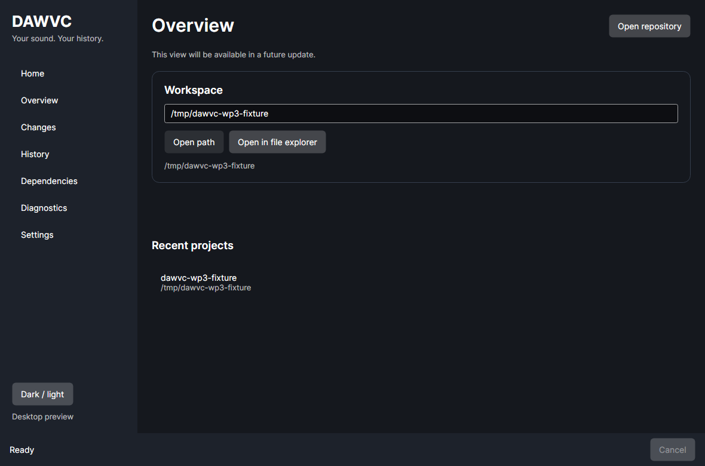
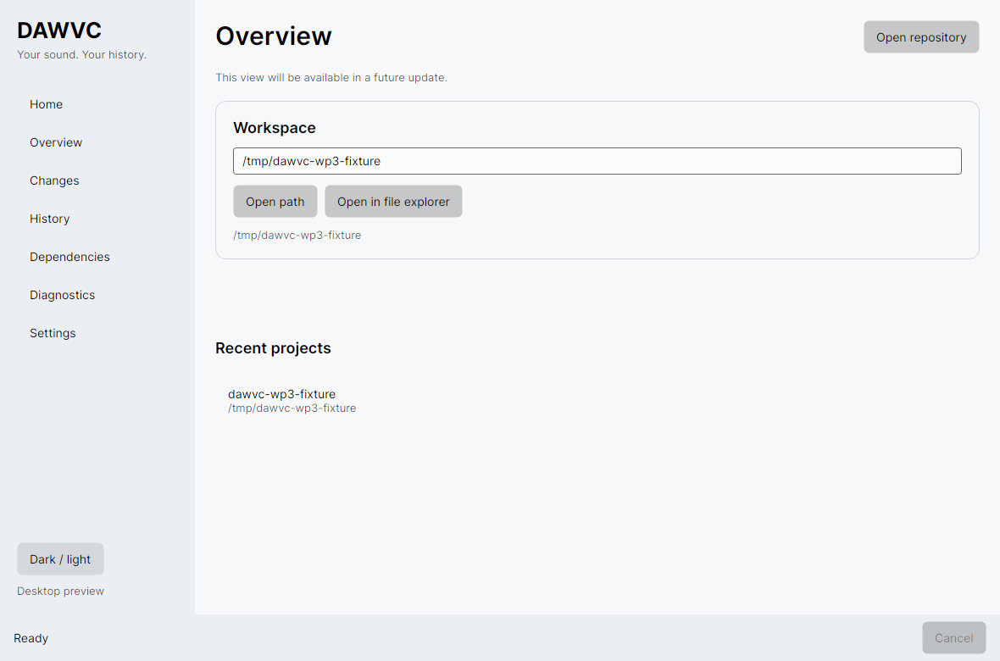

# WP4 — Avalonia Desktop foundation

13 november 2026. Branch: `feat/gui-wp4-avalonia-shell`, vanaf WP3 (`7e6cc1f`).
De gebruiker koos Avalonia expliciet voor Windows, macOS en Linux; de gewijzigde
selectiegate staat in [ADR-GUI-001](../adr/ADR-GUI-001-desktop-framework.md).

## Opgeleverd

- Productie-Desktop en Desktop.Tests in de hoofdsolution; centrale packageversies.
- Avalonia FluentTheme met gebundeld Inter, semantische themaresources en navigatie.
- Application-query voor openen zonder status/staged-indexherstel, via Bootstrap.
- Platforminterfaces voor folders, bevestiging (inclusief Escape) en file explorer.
- Lokale, begrensde MRU-opslag; atomische writes en serializeerde open-/saveacties.
- Sessiongeneraties, operatie-ID's, cancellation/disposal, serialisatie van backendwerk,
  coalesced progress en getypeerde foutpresentatie. Alle backendstartwerk op een worker.
- Verse engineprovider per operatie: gewijzigde/ontbrekende/verplaatste samples en
  gewijzigde zoekpaden worden opnieuw gezien. CLI-providerlifetimes blijven gelijk.
- Apart desktop-CI-workflow voor Windows, macOS en Linux; remote uitvoering niet geverifieerd.

## Werkelijk uitgevoerde controles

Linux x64, SDK 10.0.404, runtime 10.0.15:

- `dotnet test DawVcs.slnx -c Release -m:1`: **554/554 geslaagd**, nul skips;
  inclusief 16 desktoptests, 288 Application-tests en 27 Bootstrap-tests.
- `dotnet build DawVcs.slnx -c Release --no-restore -m:1`: **0 fouten, 0 waarschuwingen**.
- `dotnet format DawVcs.slnx --no-restore --verify-no-changes`: geslaagd voor de hoofdsolution.
- `git diff --check` en nieuwe lokale documentatielinkdoelen: geslaagd.

De desktoptests controleren stale resultaten/progress bij repositorywissel,
serialisatie en UI-threadvrijgave, busy state tijdens cancellation/disposal,
behoud van een succesvol backendresultaat na een laat annuleerverzoek, resources
op fouten, adaptercachelifetimes, command-/navigatiestates, thema en sluiten,
folderpickercancellation, dialog-Escape en MRU-concurrentie. De Application-querytests
controleren invalid/pre-cancelled entry, disposal en het ontbreken van indexgebruik.

## Native Linux-smoke

Een user-local uitgepakte Xvfb en xdotool zijn gebruikt; geen systeeminstallatie.
De eerste native run ontdekte een ontbrekend Inter-lettertype. Inter is vervolgens
gebundeld; de definitieve self-contained Linux-app start en rendert correct.
Een synthetische repository is via echte toetsenbord-/muisinvoer geopend, recente
projecten zijn onder een verse tijdelijke gebruikersdatamap opgeslagen (mode 0600),
het thema is gewisseld en de native close-handler eindigt met exitcode 0.
Een eerste focuspoging in de testdriver was te vroeg; de driver wacht nu op een
zichtbaar venster. Dit was geen extra productfout.

[Ruwe native uitkomst en assemblyhash](evidence/wp4/native-linux.json),
[validatiesamenvatting](evidence/wp4/validation.json).

## Crosspublicatie

Self-contained, zonder trimming/single-file, vanuit Linux uitgevoerd voor
`win-x64`, `linux-x64`, `osx-arm64` en `osx-x64`. Alle vier geslaagd, inclusief
gebundelde fonts en Inter-fontlicentie. [Ruwe cijfers](evidence/wp4/publications.json).
Dit bewijst compileerbaarheid/publicatie, niet native Windows/macOS-interactie.

## Grenzen en vervolg

WP4 levert een shell; repositorypagina's zijn placeholders. WP5 begint met de
viewer. SQLite-corruptieherstel dat staged entries kan wissen blijft expliciet
WP5-08; openen vraagt daarom geen status/indexherstel op. Contextconstructie kan
wel object-tempdirectories aanmaken. Geen force, commit, checkout, remotes of andere
projectinhoudmutaties in deze shell.

Native Windows/macOS-QA, fysieke Linux-desktopchecks, DPI, toegankelijkheid,
performancebudgetten, schone installatie, signing/notarization en volledige native
redistributienotices blijven WP8-releasegates. Het geselecteerde framework en de
crossplatformtargets veranderen niets aan die ontbrekende bewijslast. GitHub API
voor PR/Actions is nog geblokkeerd; er is niets goedgekeurd of gemerged.
