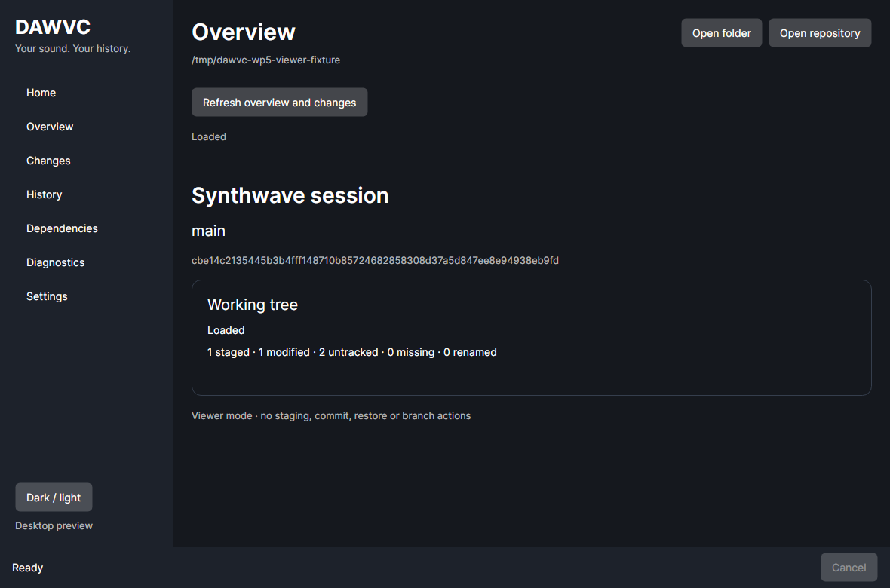
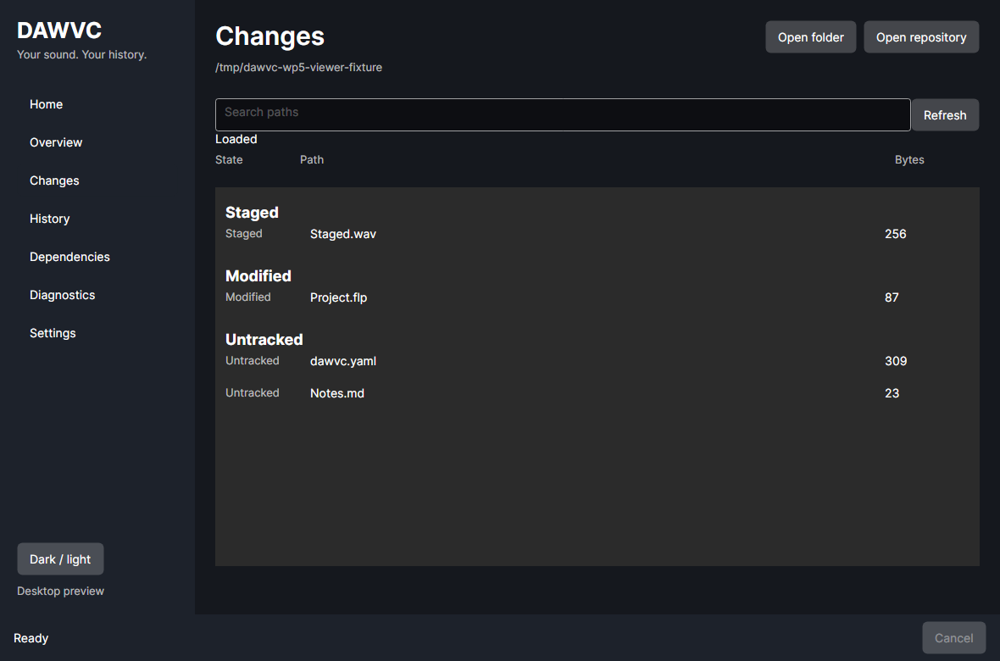
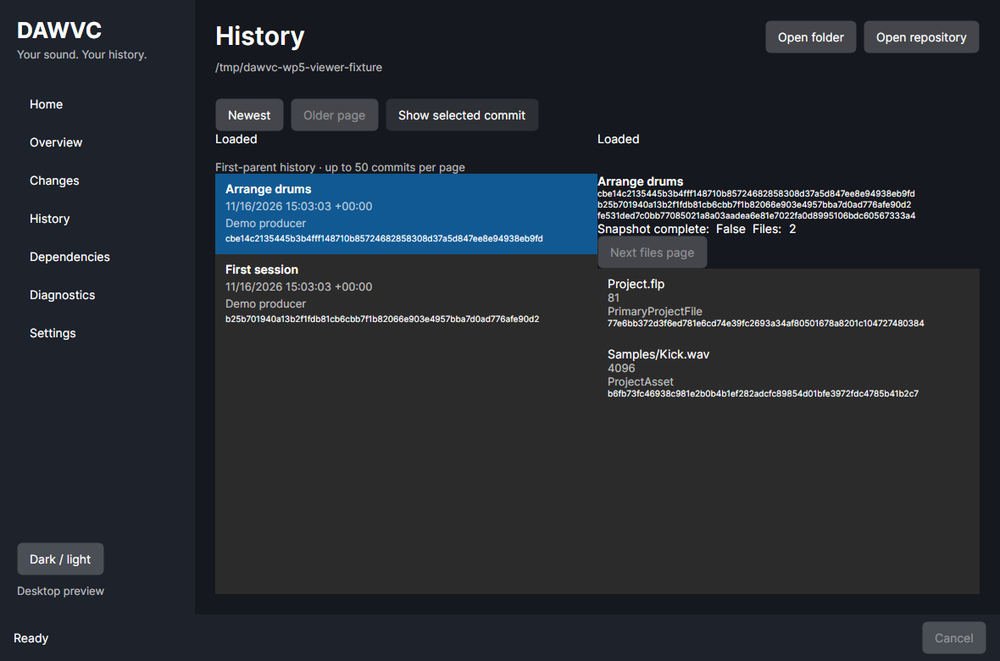
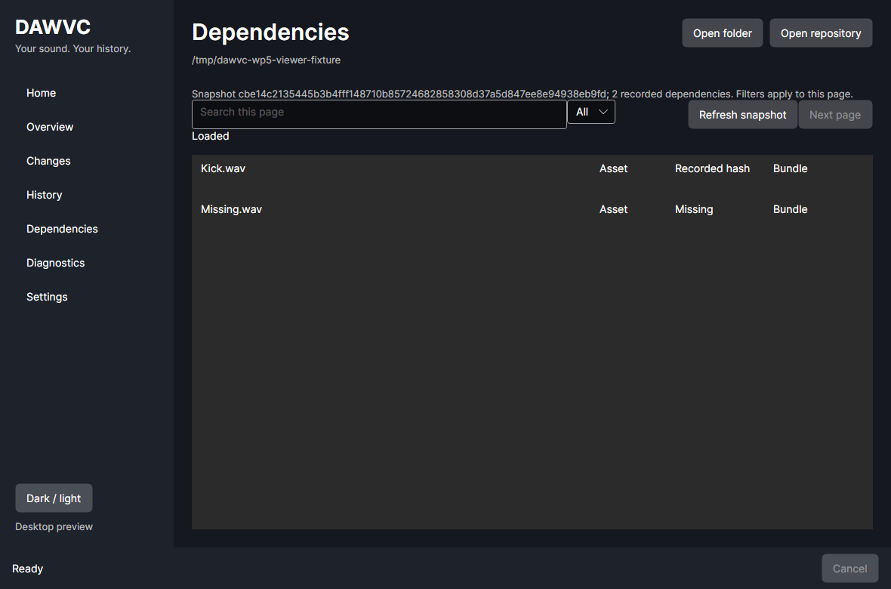
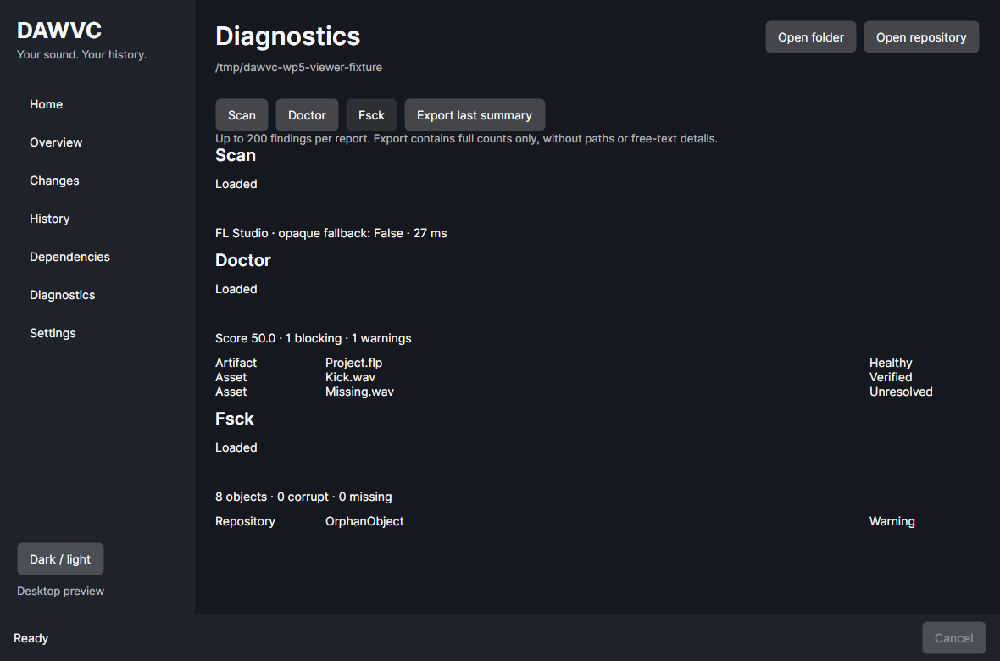

# WP5 — Viewer release

16 november 2026. Branch `feat/gui-wp5-viewer` is gemaakt vanaf de actuele
`feat_GUI` (`f27413f`, inclusief de gemergede WP4- en SQLite-poolfix).

## Functionaliteit

- Openen, recente repositories en afhandeling van ongeldige/verwijderde roots.
- Project/branch/HEAD en statusaantallen met afzonderlijke metadata-/statusstates.
- Gegroepeerde changes met zoeken, selectie en virtualisatie; geen stagingacties.
- Eerste-parentgeschiedenis met commitcursor (50 per pagina, maximaal 100),
  commit-/snapshotdetails en bestanden (200 per pagina, maximaal 500).
- Gepagineerde snapshotdependencies zonder oorspronkelijke machinepaden/locators;
  filters gelden voor de huidige pagina. Vastgelegde hashes zijn geen liveverificatie.
- Scan, Doctor en Fsck met de bestaande backend-progress/cancellationcontracten.
  Resultaatregels zijn tot 200 begrensd; samenvattingen bevatten volledige tellers.
- JSON-summaryexport met schema 1, operation/Healthy en vaste count-keys. Geen
  fouttekst, targets, auteurs, omgeving, credentials of paden. Doel buiten de repo;
  aliases via symlinks worden bij de padcontrole opgelost.

## Integriteit en metadata-effecten

Er zijn geen init/stage/commit/restore/branch/bind/remote-mutators in de viewer.
Projectinhoud, staging en refs blijven behouden. Status schrijft wel de afgeleide
hashcache. Contextconstructie kan object-tempdirectories aanmaken; de viewer is
niet strikt schrijfloos. Doctor leest bindings maar slaat ze niet op. Fsck voert
geen repair uit. Export schrijft uitsluitend na een expliciete saveactie naar een
ander pad; recente repositories blijven in gebruikersgebonden opslag.

De oude corruptie-reset van de gecombineerde cache/stagingdatabase is verwijderd.
SQLite CORRUPT/NOTADB bij initialisatie geeft `StagingIndexCorruptException`, zonder
database/WAL/SHM te verwijderen of staged intent opnieuw op te bouwen. Andere
providerfouten propageren eveneens zonder reset. ADR-009 en de Recovery Guide zijn
bijgewerkt; ook CLI-status stopt nu bij corruptie. Geen schemawijziging/resetcommand.

## Uitgevoerde validatie

Linux x64, SDK 10.0.404: **567/567 hoofdsolutiontests geslaagd**, nul skips,
waarvan 291 Application, 23 Desktop en 28 Bootstrap. De Release-build heeft
**0 fouten en 0 waarschuwingen**; de volledige formatverificatie en whitespacecheck
slagen. [Ruwe samenvatting](evidence/wp5/validation.json). Tests controleren:

- Paginering zonder ontbrekende commits, equivalentie met `LogUseCase`, immutable
  snapshotdetails, limieten en precancellation vóór contextconstructie.
- Echte Status/Doctor/Fsck-resultaten uit dezelfde Application-use-cases als de CLI,
  behoud van project/ref-bytes en staged entries, en een corrupte index met behoud
  van de oorspronkelijke bytes terwijl metadata en diagnostics beschikbaar blijven.
- Loading, empty, success, error en cancellation; reset bij repositorywissel.
- Echte changescontrol met 10.000 gesimuleerde staged rijen: 1–200 gerealiseerde
  containers, selectie en filtering naar 100 rijen.
- Export-allowlist en weigering van repositorydoelen, inclusief een gebroken
  symlink op platforms waar symlinkcreatie beschikbaar is.

## Native viewer-smoke

Linux x64 onder een tijdelijke lokale Xvfb, met uitsluitend synthetische fixtures.
De gedeelde Cloud-desktoptools waren niet callable; een lokale native display is
als testfallback gebruikt, niet als fysieke Windows/macOS-validatie.

Overview, changes, history met commit/snapshotdetails, dependencies en alle drie
diagnosticacties zijn daadwerkelijk met toetsenbord/muis bediend. Voor/na zijn
projecten, refs en objectbestanden op SHA-256 gecontroleerd en staged rows semantisch
vergeleken. De app sluit native met exitcode 0. De definitieve ruwe uitkomst staat
in [native-linux.json](evidence/wp5/native-linux.json).

## Publicatie en grenzen

Self-contained previews voor win-x64, linux-x64, osx-arm64 en osx-x64 zijn succesvol
gebouwd zonder trimming/single-file. [Publicatieresultaten](evidence/wp5/publications.json). De Windows-preview is een crosspublicatie, geen claim
van native Windows-testresultaten. Het desktop-CI-workflow test de gehele solution
en publiceert artifacts op Windows/macOS/Linux; remote resultaten blijven apart
van lokaal uitgevoerd bewijs. Geen GitHub-release, signing of installer gepubliceerd.

Volledige snapshotmetadata wordt nog als object gedeserialiseerd; paginering beperkt
UI/query-output, niet de bestaande objectreaderallocatie. History volgt de eerste
parent; geen mergevisualisatie. Volledige vrije diagnosticdetails zijn niet in de
summaryexport opgenomen. Native Windows/macOS en fysieke desktop-, DPI-, accessibility-,
performance- en distributieacceptatie blijven WP8. WP6 is nog niet gestart.
